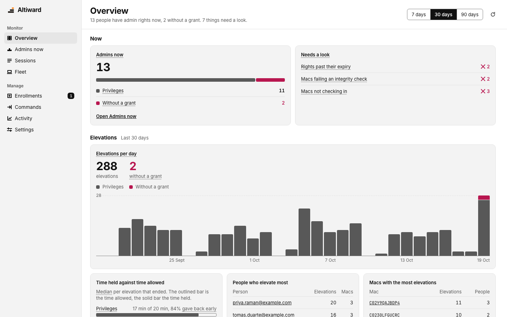

<p align="center">
  
</p>

<h1 align="center">Altiward</h1>

<p align="center">
  Self-hosted oversight of Mac admin rights alongside SAP Privileges: who held admin and
  why, checked against the real <code>admin</code> group and sent to your SIEM.
</p>

<p align="center">
  <a href="https://github.com/Altiward/altiward/actions/workflows/ci.yml"></a>
  <a href="https://github.com/Altiward/altiward/releases?q=server-v&expanded=true"></a>
  <a href="https://github.com/Altiward/altiward/releases?q=agent-v&expanded=true"></a>
  <a href="LICENSE"></a>
  <a href="https://www.bestpractices.dev/projects/15960"></a>
  <a href="https://scorecard.dev/viewer/?uri=github.com/Altiward/altiward"></a>
</p>



## What it does

Altiward works alongside [SAP Privileges](#works-with-sap-privileges): Privileges grants
admin rights, and Altiward watches and enforces them. It never grants admin itself.

Altiward is an agent for each Mac, a server you run, and a web console. The agent records
each change Privileges reports, checks it against the Mac's real `admin` group, and reads
the group itself to catch anyone made admin another way. The server keeps the history,
and the console shows it:

- **Who has admin rights now,** and every elevation before: who, on which Mac, for how
  long and with what reason.
- **Admin rights nobody granted.** Every claim is checked against the real `admin` group,
  and a regular reading of the group catches anyone added outside the normal route. With
  Privileges' system extension on, it says which process added them. If you choose
  (`OutOfBandEnforcement`), the agent removes them from `admin` after a few minutes.
- **Expiry.** Rights that outlive the expiry Privileges set raise an alert, or, if you
  choose (`ExpiryEnforcement`), the agent removes the user from `admin`.
- **Revoke from the console,** per session, per account on a Mac, or every admin on a
  Mac. The agent picks the command up from your server within about a second and removes
  the rights from `admin` itself. Accounts you list as permanent admins are never removed.
- **Use of permanent admin accounts.** Each sign-in by an account in `PermanentAdmins`
  (at the Mac, in Terminal or over SSH), each time its password is typed into an admin
  prompt on someone else's session, and its screen sharing. This is evidence for your
  SIEM and the Mac's details, not an alert. `sudo`, `su` and SSH file copies aren't
  recorded until Apple grants the Endpoint Security entitlement, as macOS keeps no log
  line for them ([what is recorded](docs/data-handling.md)).
- **Tamper and health.** Alerts when the agent's LaunchDaemon or signature is changed, its
  server, permanent admins, expiry enforcement, out-of-band enforcement or hook requirement
  settings are set outside MDM, or it is downgraded; when Privileges' own protection is off
  or Altiward's hook isn't set in Privileges, someone stops Privileges' timer while holding
  rights it granted, or Privileges blocks an attempt to remove or unload it; and when a Mac
  stops checking in.
- **What changed while someone was admin:** launch items, sudoers, SSH keys, local
  accounts and remote access.
- **Your SIEM gets every event** as OCSF, along with every console action. Events wait
  in Postgres until the SIEM accepts them, so an outage delays them without losing any.
- **Single sign-on** with OpenID Connect and three roles (viewer, operator, admin), and an
  audit trail of every console change.

You run the server. The agent talks only to your server, and the server talks only to
your database, your SIEM and your identity provider: no telemetry, no registration, and
no update checks from the server. The console tells admins when a newer release is out:
their browser asks GitHub's API for the release list, sending nothing about your fleet,
and `ALTIWARD_UPDATE_CHECK=false` turns it off. [Data handling](docs/data-handling.md)
lists what is collected, stored and sent, for your security review.

### How it fits together

<picture>
  <source media="(prefers-color-scheme: dark)" srcset="docs/images/architecture-dark.svg">
  
</picture>

Privileges runs the hook as the logged-in user, who can call it with anything, so it is
untrusted: the agent, running as root, verifies everything it says against the `admin`
group and takes its own timestamps. Each Mac enrolls with its own key and signs what it
sends, so nothing can send as an enrolled Mac without its key. A new key for a Mac that is
already enrolled waits for your approval by default, while its current key keeps reporting.
Turning **Approve Macs that enrol again** off lets anyone with the enrolment token replace
an enrolled Mac's identity by naming its serial and hardware UUID, neither of which is a
secret. The shared token cannot establish that a serial enrolling for the first time
belongs to the caller: check new enrolments against your device inventory. The agent
replaces its own key from time to time, so a key copied from a Mac's backup goes stale: if
both the Mac and the copy use one, the server revokes the key and raises an alert, and the
Mac enrols again ([a rotated key was used](docs/install.md#a-rotated-key-was-used)).
See [settings](docs/install.md#6-settings-worth-reviewing) and the agent's
[design notes](agent/README.md#design-notes).

### Status

The agent needs macOS 13 or later.

Known limits:

- Altiward needs SAP Privileges to grant admin rights; it has no way to grant them itself.
  Without Privileges, every admin who isn't a permanent admin shows as one nobody granted.
- `OutOfBandEnforcement` defaults to `alert`. If you set it to `enforce`, the agent removes
  every admin nobody granted, within minutes, including the LAPS account your MDM manages
  if it isn't in `PermanentAdmins`, and, without Privileges, every admin who isn't a
  permanent admin. It never removes a permanent admin, and keeps at least one standing
  admin: a permanent admin, or else the admin nobody granted it has seen longest (someone
  holding admin through a Privileges grant doesn't count). It pauses while the
  **Privileges reports to Altiward** check fails; a removed Privileges grant whose hook
  never reached the agent can be requested again. Pilot it on a small group first
  ([Enforcement](docs/install.md#enforcement)).
- Expiry comes from Privileges. A grant Privileges gives no expiry never counts as past
  its expiry, and `ExpiryEnforcement` defaults to `alert`: rights are removed only if you
  set it to `enforce`.
- The device key is in the Secure Enclave on Macs that have one: the agent moves a file
  key there by itself. On Intel Macs without a T2 chip it's a root-only file, replaced
  every 30 days, which someone with admin rights could copy. Rotation proves a key's
  continuity, not who enrolled first: a serial enrolled before its real Mac keeps that
  identity ([the agent's design notes](agent/README.md#design-notes)).
- Identity mapping uses the `UserPrincipalNames` preference; Platform SSO isn't read yet.
- No settings editor in the console, and no Jamf Pro, Intune, Entra ID or Okta
  integrations beyond single sign-on. Settings come from the `com.altiward.agent` profile.
- Altiward doesn't have Apple's Endpoint Security entitlement, so it shows what changed
  during an elevation rather than every process that ran; your EDR covers that. The
  process behind admin rights nobody granted comes from Privileges' own system extension,
  so it needs Privileges 2.6 or later with the extension on, on macOS 14 or later.
- Persistence found during an elevation is reported, never undone, except for admin
  rights: an account an elevated user created as an admin, or added to `admin`, holds
  rights nobody granted, and with `OutOfBandEnforcement` on `enforce` the agent removes
  them (the account stays). Responding to the rest is a job for your EDR or MDM: Altiward
  changes nothing on a Mac but the `admin` group.

## Quick start

To look around first, run the console with demo data using only Docker:

```sh
git clone https://github.com/Altiward/altiward && cd altiward
docker compose -f dev/compose.demo.yaml up --build

# When you're done, from the same folder:
docker compose -f dev/compose.demo.yaml down -v
```

When it says `Demo ready`, open http://localhost:8080 and sign in with
`dev-console-token-001`. It keeps running until you stop it with the last command, which
also deletes the demo data; leave out `-v` to keep it. [dev/README.md](dev/README.md) has
the details and fixes for common errors.

For a real deployment you need a Linux server with Docker Compose, two DNS names (one for Macs, one for the
console), and an MDM. The [install guide](docs/install.md) covers each step, running on
your own Postgres or load balancer, backups and troubleshooting. On Azure,
[Deploy to Azure](deploy/azure/README.md) creates the server in your
subscription instead, on Azure Container Apps, with no VM to look after:

[](https://portal.azure.com/#create/Microsoft.Template/uri/https%3A%2F%2Fraw.githubusercontent.com%2FAltiward%2Faltiward%2Fserver-v1.0.0%2Fdeploy%2Fazure%2Fazuredeploy.json/createUIDefinitionUri/https%3A%2F%2Fraw.githubusercontent.com%2FAltiward%2Faltiward%2Fserver-v1.0.0%2Fdeploy%2Fazure%2FcreateUiDefinition.json)

**1. The server.** Download the server release from
[GitHub Releases](https://github.com/Altiward/altiward/releases) (tagged `server-v1.0.0`),
[check its signature](docs/install.md#checking-a-release), then:

```sh
docker load -i altiward-api-1.0.0-linux-amd64.tar.gz   # or pull ghcr.io/altiward/altiward-api:1.0.0
tar xzf altiward-server-1.0.0.tar.gz
sudo mkdir /opt/altiward && sudo chown "$(id -un)" /opt/altiward
cp -R altiward-server-1.0.0/deploy/compose/. /opt/altiward/ && cd /opt/altiward
cp env.example .env && chmod 600 .env
# In .env: your two hostnames, the networks allowed to open the console, a Postgres
# password, and an agent token and a console token.
docker compose up -d
```

Caddy gets certificates for both hostnames, and you sign in to the console with the
console token until you set up single sign-on. To upgrade later, put the new release's
files in a directory and run `./upgrade.sh ~/altiward-1.0.1` from `/opt/altiward`: it
checks the signature, backs up the database and asks before changing anything.

**2. The agent.** From the agent release (tagged `agent-v1.0.0`), deploy through your MDM,
to a pilot group first:

1. A configuration profile for `com.altiward.agent`, from the example in the bundle's
   `profiles/`, with at least `ServerURL`, `EnrollmentToken` and `PermanentAdmins`. Set
   `ExpiryEnforcement` to `enforce` if the agent should remove rights past their expiry;
   by default it only alerts. `OutOfBandEnforcement` works the same way for admins nobody
   granted, and needs a `PermanentAdmins` list that covers your MDM's admin accounts
   ([Enforcement](docs/install.md#enforcement)).
2. The login items profile, `altiward-login-items.mobileconfig`.
3. The keys from `corp.sap.privileges.plist` in the **matching agent release** added
   to your Privileges profile, so Privileges reports each change to the agent.
4. The signed and notarized package, `Altiward-1.0.0.pkg`. It installs silently and the
   agent starts at once.

Each Mac enrolls on first contact and shows up in the console's Fleet view.

## Works with SAP Privileges

[SAP Privileges](https://github.com/SAP/macOS-enterprise-privileges) is an open-source
(Apache 2.0) app that lets people on a Mac become admin for a limited time. Altiward
relies on it to grant admin, and doesn't replace or modify it:

- Altiward uses only Privileges' documented `corp.sap.privileges` settings. The example
  profile sets Altiward's hook as Privileges' post-change executable and turns on
  Privileges' own tamper protection, and Altiward reports any Mac where that protection
  is off or its system extension isn't running.
- Expiry, revoke and the heartbeat act on the `admin` group directly, never through
  Privileges, so they work whatever Privileges does.

Altiward is an independent project, not affiliated with or endorsed by SAP.

## SIEM

The server sends every event, and every console action, to your SIEM in
[OCSF](https://schema.ocsf.io): admin grants and removals as User Access Management,
console actions as API Activity. Set it up in `.env`
([install guide, step 4](docs/install.md#4-connect-your-siem)):

- **Splunk** through the HTTP Event Collector, with a starter dashboard:
  [integrations/splunk](integrations/splunk/)
- **Microsoft Sentinel** through the Logs Ingestion API, with a one-step setup script and
  a workbook: [integrations/sentinel](integrations/sentinel/)
- **Syslog** over TLS or TCP, as CEF or OCSF JSON, for QRadar, ArcSight, Elastic and
  others: [integrations/syslog](integrations/syslog/)

Detection rules and searches for Sentinel and Splunk are in
[**altiward-siem**](https://github.com/Altiward/altiward-siem). The dashboard and workbook
stay with the integrations linked above. [**altiward-forwarder**](https://github.com/Altiward/altiward-forwarder)
forwards SAP Privileges events without the Altiward agent.

## Docs

- [Architecture and source layout](docs/architecture.md): component boundaries and where to contribute
- [Install guide](docs/install.md): server, agent, SIEM, single sign-on, upgrades, backups
- [Deploy to Azure](deploy/azure/README.md): the server on Azure Container Apps
- [Data handling](docs/data-handling.md): what Altiward collects, stores and sends
- [Design notes](agent/README.md#design-notes): the agent's trust model, and why
  Privileges stays at the edge
- [Event schema](docs/schema/README.md): the agent-to-server contract, with fixtures
- [Agent](agent/README.md), [server](backend/README.md), [console](console/README.md)
  and [deployment files](deploy/compose/README.md)
- [SIEM integrations](integrations/README.md)
- [Releasing](docs/releasing.md) and the [roadmap](https://github.com/orgs/Altiward/projects/1)

### Repository layout

The agent, server and console live together so changes to their shared contracts can be
reviewed and tested in one place. Deployment configuration, local development tools and
shared artwork have their own directories:

```text
altiward/
├── agent/                  Swift package
│   ├── Sources/            Shared core, root daemon and Privileges hook
│   ├── Tests/              Agent tests
│   └── packaging/          Mac installer, launchd resources and verification
├── backend/                Go server
│   ├── cmd/altiward-api/    Server entry point and command-line tools
│   └── internal/           HTTP API, authentication, reducers, store and exports
├── console/                React and TypeScript web console
├── integrations/           Reusable Go SIEM clients and current SIEM content
├── assets/brand/           Canonical logos, app-icon sources and avatars
├── dev/                    Local Postgres Compose file and demo seed
├── deploy/
│   ├── compose/            Production server, Postgres, TLS and upgrades
│   ├── mdm/                Mac configuration-profile templates
│   └── sentinel/           Azure resource provisioning and its tests
├── scripts/                Release, notices and brand-generation tools
└── docs/                   Architecture, operations and shared contracts
    ├── schema/             Native event/command examples and frozen compatibility fixtures
    ├── images/             Documentation screenshots
    └── brand/              Generated repository social preview
```

### Where new work belongs

| Work | Start here |
| --- | --- |
| Mac behaviour or the hook | [Agent](agent/README.md); keep Swift tests beside the package |
| Server handlers, state or storage | [Backend](backend/README.md); keep Go tests with their package and migrations with the store |
| Console views and shared controls | [Console](console/README.md) |
| SIEM transport clients | [Integrations](integrations/README.md), a separate Go module for reuse |
| Production configuration and MDM templates | [Deployment](deploy/README.md) |
| Local services and simulated Macs | [Development tools](dev/README.md) |
| Logos or generated artwork | [Brand sources and export instructions](assets/brand/README.md) |
| Release automation and generated notices | [Repository tools](scripts/README.md) |
| Wire-format changes | [Shared contracts](docs/schema/README.md); update both implementations and current examples together |

Root-level `Makefile`, `Dockerfile`, Go module/workspace files and project policies
coordinate the whole repository. The event fixtures under `docs/schema/compat/` are
intentional frozen copies: preserve them when current examples change.

The website and organisation profile have their own repositories and keep exported
assets locally. Detection rules and searches are in
[altiward-siem](https://github.com/Altiward/altiward-siem); the dashboard and workbook
remain here. See
[Architecture and source layout](docs/architecture.md) for ownership and data flow.

## Contributing and security

Contributions are welcome under the Developer Certificate of Origin: sign off each commit
with `git commit -s`. See [CONTRIBUTING.md](CONTRIBUTING.md).

To build and test from source you need macOS with Xcode or the Command Line Tools,
Go 1.27+, Node 22.12+ and Docker:

```sh
make console-install   # once: console dependencies
make test              # Swift agent, Go and console tests
make test-db           # also runs the Postgres store suite (starts Postgres in Docker)
make run-api           # API on :8080 with development tokens
make console-seed      # in another terminal: demo Macs, sessions, an enrollment to approve
make console-dev       # console on :5173; sign in with dev-console-token-001
make package package-verify   # ad hoc signed Altiward.app and .pkg
```

`make help` lists everything.

**Found a vulnerability?** Please don't open a public issue. Report it privately through
[GitHub security advisories](https://github.com/Altiward/altiward/security).

## Licence

Altiward is licensed under the [Apache License 2.0](LICENSE); see also [`NOTICE`](NOTICE).
The open-source components it ships are listed with their licences in
[`THIRD_PARTY_NOTICES.md`](THIRD_PARTY_NOTICES.md). "SAP" and "Privileges" are used only
to describe compatibility; Apache 2.0 grants no rights to the Altiward name or logo.
