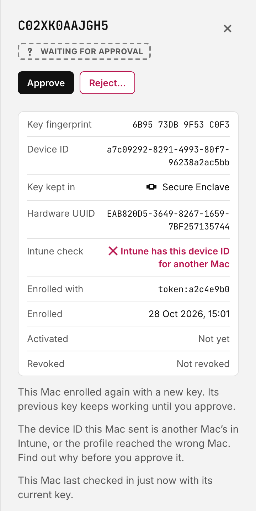
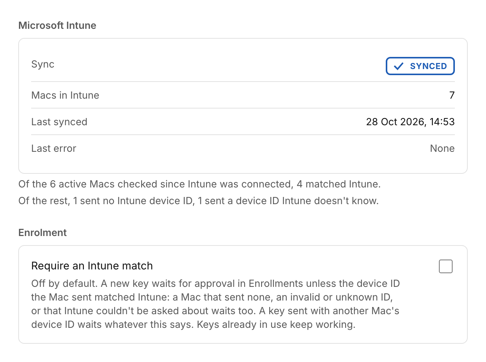
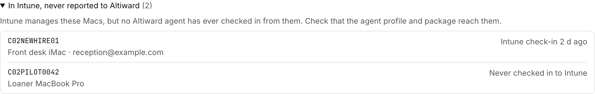

# Installing Altiward

This guide takes you from nothing to Macs reporting to your own Altiward server. You run
the server; the Altiward project never receives your data. For your security review,
[data handling](data-handling.md) lists what Altiward stores and where data goes.

To look around before you install, the
[demo](https://github.com/Altiward/altiward/blob/main/dev/README.md#try-the-console-with-demo-data)
runs the console with example data on your own computer, needing only Docker.

## What you're installing

<picture>
  <source media="(prefers-color-scheme: dark)" srcset="images/install/overview-dark.svg">
  
</picture>

- **The agent** runs on each Mac as a background service, installed by your MDM. It works
  alongside SAP Privileges, which grants admin rights: it records every grant and revoke
  Privileges reports, checks them against the real `admin` group, and sends events to
  your server. It never grants admin itself.
- **The server** is one container serving the API and the web console, with Postgres for
  storage and Caddy in front for TLS.
- **Two hostnames.** Macs report to the *agent hostname*, which must be reachable from
  the internet so laptops can report from home and on the road. Only the agent endpoints
  answer there. Anything between the Macs and the server, such as a firewall, web filter
  or TLS-inspecting proxy, must pass the whole of `/v1/agent/` to the server unaltered,
  including `/v1/agent/rotate`, which the agent uses to replace its key. People use the
  *console hostname*, which only accepts connections from the networks you list. On Azure
  Container Apps, one address serves both, split by path, with the same rule.

## Choose how to run it

Altiward is the same software however you run it. Pick the setup that
matches what you already have:

| | The bundle | Your own infrastructure | Azure Container Apps |
| --- | --- | --- | --- |
| For | A site that wants Altiward to bring everything it needs | A site with a managed database and its own load balancer or certificates | A site on Azure that wants no server or VM to look after |
| Database | Postgres in the bundle, backed up by you ([Backups](#backups)) | Your managed Postgres ([An existing Postgres](#an-existing-postgres)) | Azure Database for PostgreSQL on a private network, with Azure's backups |
| TLS | Caddy, with certificates from Let's Encrypt | Your certificates or load balancer ([Your own certificates or load balancer](#your-own-certificates-or-load-balancer)) | The Container Apps ingress, on its own address or your domain |
| Steps | This guide as written | This guide, plus the sections linked here | [Deploy to Azure](../deploy/azure/README.md), then this guide from step 2 |

The bundle and your own infrastructure use the same image and the same `deploy/compose`
files, so you can move from one to the other later without reinstalling. Deploy to Azure
runs the same image, set up by a template, with settings on the container app instead of
in `.env`: wherever this guide says to set something in `.env` and run
`docker compose up -d`, set it on the container app instead
([Changing settings](../deploy/azure/README.md#changing-settings)). If you run Kubernetes,
[open an issue](https://github.com/Altiward/altiward/issues): manifests or a Helm chart
come when someone needs them.

[](https://portal.azure.com/#create/Microsoft.Template/uri/https%3A%2F%2Fraw.githubusercontent.com%2FAltiward%2Faltiward%2Fserver-v1.1.0%2Fdeploy%2Fazure%2Fazuredeploy.json/createUIDefinitionUri/https%3A%2F%2Fraw.githubusercontent.com%2FAltiward%2Faltiward%2Fserver-v1.1.0%2Fdeploy%2Fazure%2FcreateUiDefinition.json) ([what it creates](../deploy/azure/README.md))

## Before you start

You need:

- **A Linux server or VM** with Docker Engine and the Docker Compose plugin. As a starting
  point, not a measured requirement: 2 vCPUs, 4 GB of memory and 20 GB of disk. Altiward
  keeps history for a year once a SIEM is connected, and for good until then (see
  [Settings worth reviewing](#6-settings-worth-reviewing)), so watch disk use as your fleet
  grows.
- **Two DNS names** pointing at the server, for example `altiward-agents.example.com`
  and `altiward.example.com`.
- **Ports 80 and 443** reachable on the server from the internet, so Caddy can get
  certificates and Macs can report. To keep the server off the internet, see
  [Your own certificates or load balancer](#your-own-certificates-or-load-balancer).
- **Macs on macOS 14 or later**, Apple silicon or Intel, with SAP Privileges 2.5 or later
  and its system extension on. With Privileges 2.6 or later, the agent also confirms each
  grant against Privileges' own log
  ([Claims made by running the hook by hand](#claims-made-by-running-the-hook-by-hand)).
- **Your MDM** (Jamf Pro, Intune, Kandji, Mosyle or similar) to install the package and
  configuration profiles.
- **From [GitHub Releases](https://github.com/Altiward/altiward/releases):** a server
  release and an agent release. A server
  release is the bundle (`altiward-server-<version>.tar.gz`, holding the deployment files
  in `deploy/compose/`, this guide, the SIEM guides and the Sentinel and Intune setup scripts and the Intune
  profile script in `integrations/`, and the agent's example Mac profiles in `profiles/`), the server image
  as a file for your platform (`altiward-api-<version>-linux-amd64.tar.gz` or `…-arm64`),
  `RELEASE_NOTES.md`, `SHA256SUMS` and its signature, `SHA256SUMS.sigstore.json`. An
  agent release is the signed package
  (`Altiward-<version>.pkg`), the SAP Privileges keys pinned to that package's hook
  (`corp.sap.privileges.plist`, and the same keys as a ready-made profile,
  `corp.sap.privileges.mobileconfig`), and its own notes and checksums. Server releases are tagged
  `server-vX.Y.Z` and agent releases `agent-vX.Y.Z`. Nothing needs an account.

## 1. Start the server

On the server, download the server release into a directory of its own. Set `v` to the
release's version, and on an Arm server use `arm64` in place of `amd64`:

```sh
v=<version>
mkdir ~/altiward-$v && cd ~/altiward-$v
for f in altiward-server-$v.tar.gz altiward-api-$v-linux-amd64.tar.gz \
    RELEASE_NOTES.md SHA256SUMS SHA256SUMS.sigstore.json; do
  curl -fsSLO "https://github.com/Altiward/altiward/releases/download/server-v$v/$f"
done
```

Check the files ([Checking a release](#checking-a-release)), then load the image, unpack
the bundle and copy its deployment files to the directory the server runs from, such as
`/opt/altiward`. Keep the server in that directory: upgrades work in it, whatever version
it runs. (The image is also public at `ghcr.io/altiward/altiward-api`, pulled without
logging in: skip `docker load` and `docker compose up -d` below pulls it.)

```sh
docker load -i altiward-api-$v-linux-amd64.tar.gz
tar xzf altiward-server-$v.tar.gz
sudo mkdir /opt/altiward && sudo chown "$(id -un)" /opt/altiward
cp -R altiward-server-$v/deploy/compose/. /opt/altiward/
cd /opt/altiward
```

In that directory, holding `compose.yaml`, `Caddyfile` and `env.example`:

```sh
cp env.example .env
chmod 600 .env
```

Edit `.env`. `ALTIWARD_VERSION` is already set to the release you downloaded.

| Setting | What to put |
| --- | --- |
| `ALTIWARD_AGENT_HOST`, `ALTIWARD_CONSOLE_HOST` | Your two hostnames |
| `ALTIWARD_CONSOLE_ALLOW` | The networks allowed to open the console, space separated, for example your office and VPN ranges |
| `POSTGRES_PASSWORD` | A new random value: `openssl rand -hex 24` |
| `ALTIWARD_AGENT_TOKENS` | `yourcompany=` followed by a new random value from `openssl rand -hex 32`. It goes into the Mac profile. |
| `ALTIWARD_CONSOLE_TOKENS` | `yourcompany=` followed by a different value from `openssl rand -hex 32`. People sign in to the console with it until you set up single sign-on ([step 5](#5-sign-in-with-your-identity-provider)); after that it is a break-glass login, which you can keep or turn off ([Console token and break-glass](#console-token-and-break-glass)). |

Use the same organisation name in both token settings.

You can give each group of Macs its own agent token, one per MDM profile, listed comma
separated: `yourcompany=<first>,yourcompany=<second>`. **Enrollments** shows which token
each key enrolled with, so if one leaks you change only that group's profile and can find
the keys it made.

Then start everything:

```sh
docker compose up -d
docker compose ps        # all three services should be running
```

Caddy gets certificates for both hostnames within a minute. Open
`https://<console hostname>` from an allowed network and sign in with the console token.
The Fleet view is empty until the first Mac reports.

**You should see** the sign-in page, with a padlock in the address bar. A certificate
warning, or no page at all, is a Caddy problem: see
[Caddy certificate errors](#caddy-certificate-errors).

<picture>
  <source media="(prefers-color-scheme: dark)" srcset="images/install/sign-in-token-dark.png">
  
</picture>

## 2. Deploy the agent

Create these in your MDM and scope them to a pilot group first.

1. **Configuration profile for `com.altiward.agent`**, from the example
   `com.altiward.agent.plist`, or `com.altiward.agent.mobileconfig` for an MDM that takes
   a profile file. Set at least:
   - `ServerURL`: `https://<agent hostname>`
   - `EnrollmentToken`: the token after `yourcompany=` in `ALTIWARD_AGENT_TOKENS`
   - `MDMDeviceID`: your MDM's own ID for the Mac, which the agent sends once, when it
     enrols. Leave it as `{{deviceid}}` for Intune, which fills in each Mac's device ID.
     Leave the key out for another MDM.
   - `PermanentAdmins`: accounts that should always be admins, such as your IT or
     break-glass accounts. Altiward never flags or removes them. Include the local
     admin account your MDM manages with LAPS (Jamf Pro's managed local administrator,
     or the macOS local admin account Intune creates at enrollment): enter the short name
     you set in the MDM, exactly. Left out, it shows in the console as an admin nobody
     granted, revoking every admin on a Mac would remove its rights too, and with
     `OutOfBandEnforcement` set to `enforce` Altiward removes them itself. Altiward
     records each sign-in, prompt approval and screen sharing connection by these accounts
     (`sudo`, `su` and SSH file copies wait for Apple's Endpoint Security entitlement;
     [what it records](data-handling.md)); the MDM records who
     looked up the password.

     > **Warning:** With `OutOfBandEnforcement` set to `enforce`, every admin nobody
     > granted loses their rights within minutes, including the LAPS account your MDM
     > manages if it isn't in `PermanentAdmins`. Read [Enforcement](#enforcement) before
     > turning it on.

   - `UserPrincipalNames` (optional): each local account's UPN, which events carry so your
     SIEM can tie an elevation to the person. On a Mac registered for Platform SSO, the
     agent takes the UPN from the Entra ID account Platform SSO links to each Mac account,
     so you can leave this out. It reads the link from the Mac's local directory: the
     account Platform SSO signed in with, normally the person's UPN. An entry here wins over
     the link, but only from MDM: a map set with `defaults write` is reported as tampering
     and the link wins over it. Map an account here if you need certainty about its UPN:
     an admin can change a Platform SSO link, and Altiward reports that only when it
     happens while someone holds admin rights it records (see below).
   - `PlatformSSOIdentity` (optional): set it to `false` if your data protection rules allow
     only UPNs you supply. The agent then reads no Platform SSO links: UPNs come only from
     `UserPrincipalNames`, and a changed link is no longer reported. Only MDM can turn it
     off; a value set with `defaults write` is ignored and reported as tampering.

   The example explains every other key. `HeartbeatInterval` is 5 minutes by default and at
   most 3600 seconds (a larger value counts as an hour), so a running agent checks in at
   least hourly. Two keys let the agent act, not only report: `ExpiryEnforcement`, for
   rights that outlive the expiry Privileges set, and `OutOfBandEnforcement`, for admin
   rights nobody granted. Both default to `alert`, which only reports. Keep them there for
   the pilot ([Enforcement](#enforcement)).

   Deliver the profile through MDM rather than `defaults write`: Altiward reports
   `ServerURL`, `PermanentAdmins`, `ExpiryEnforcement`, `ExpiryGraceMinutes`,
   `OutOfBandEnforcement`, `OutOfBandGraceMinutes`, `UserPrincipalNames`,
   `PlatformSSOIdentity` or `HookCodeRequirement` set outside MDM as tampering (it doesn't
   check the other keys).

   **Where a UPN comes from.** An elevation keeps the UPN its user had when the grant
   arrived, so changing a Platform SSO link during the elevation can't move it onto someone
   else. A link added, changed or removed while someone holds admin rights is reported on
   their session as a changed account (**Changed account jdoe** in the console,
   `persistence.detected` in your SIEM), with the account's new link in `platform_sso`. A
   person's UPN changing in Entra ID is the usual innocent cause: their Entra ID audit log
   shows it. A change while nobody is elevated, which only a permanent admin or your MDM
   can make, isn't reported.
2. **Login items profile** (`altiward-login-items.mobileconfig`), so people can't turn
   the agent off and don't see a background-item notice.
3. **SAP Privileges:** download `corp.sap.privileges.plist` from the **same agent release
   as the package** and add its keys to your existing Privileges profile. Its checksum
   pins that package's signed hook: Privileges won't run a hook whose checksum doesn't
   match, and Altiward reports *SAP Privileges no longer reports to Altiward* for that
   Mac. The keys set the hook, so Privileges
   reports each change to Altiward, and turn on Privileges' tamper protection
   (`EnableSystemExtension`). That protection is a system extension, which also needs,
   from your MDM: a system extension policy allowing SAP's team `7R5ZEU67FQ` and Full Disk
   Access for `corp.sap.privileges.extension`. SAP's example
   `Example_ApprovePrivileges.mobileconfig` has both. Until it's on and the extension is
   running, Altiward reports *SAP Privileges tamper protection is off* for each Mac.
   We also suggest `ReasonRequired` (and `ReasonMinLength`), if your profile doesn't set them:
   Privileges keeps the reason someone gives only when it requires one, so without it Altiward
   records no reason.

   Privileges lets users change, in its own settings, any setting its profile doesn't set.
   The file sets three that Altiward relies on, and suggests two more. Altiward checks each
   Mac, and shows a failing check in the Mac's details for any that's missing:

   | Setting | In the file | Why | Check |
   |---|---|---|---|
   | `ExpirationIntervalMax` | 60 minutes: use your own policy's value. A fixed `ExpirationInterval` works too, and is stricter | Without a cap, a user can choose to keep admin rights with no expiry, and expiry enforcement has nothing to enforce | **Privileges expiry cap**, medium severity |
   | `AllowPrivilegeRenewal` | `false`. Don't set `AutoRenewalProcessPaths`, which renews whatever this says | Privileges reports a renewal only in a log line from a process the user runs. The agent checks it came from SAP's agent and moves the expiry, but it can't check a line whose process has gone, and then removes renewed rights at the original expiry. With renewals off, it ignores renewal lines altogether | **Privileges renewals off**, medium, only while `ExpiryEnforcement` is `enforce` |
   | `PostChangeActionOnGrantOnly` | `false` | Unset, a user can tick "Run only if administrator privileges have been granted", and Privileges stops telling Altiward when rights are given back | **Privileges reports give-backs**, medium |
   | `RevokePrivilegesAtLogin` with `RevokeAtLoginExcludedUsers` | Suggested, in a comment | Rights never survive a restart | **Privileges spares permanent admins**, medium |
   | `RevokePrivilegesAfterSystemTimeChange` with `RevokeAfterTimeChangeExcludedUsers` (Privileges 2.4.1 or later) | Suggested, in a comment | Nobody can stretch an expiry by setting the clock back | The same check |

   Only values your MDM profile sets count for the first three: a value in
   `/Library/Preferences` is still one the user can change. The two revoke settings aren't
   required, but if you turn either on, its exclusion list must name **every account in
   `PermanentAdmins`** (break-glass, LAPS, your MDM's admin account): Privileges makes any
   other admin a standard user at their next sign-in, or when the clock changes. The file
   leaves them in a comment for that reason, and Altiward fails the check while a list
   leaves a permanent admin out.
4. **The package**, `Altiward-<version>.pkg`. It installs silently, and the agent starts
   at once.

**In Jamf Pro:**

- Agent settings: **Computers › Configuration Profiles › New**, payload **Application &
  Custom Settings › Upload › Add**, preference domain `com.altiward.agent`, then upload your
  edited `com.altiward.agent.plist`.
- Login items: **Computers › Configuration Profiles › Upload**, then
  `altiward-login-items.mobileconfig`.
- The package: add it in **Settings › Computer management › Packages**, then install it
  with a policy (**Computers › Policies**, payload **Packages**, action **Install**).

**In Intune** (the Microsoft Intune admin center):

- Agent settings: **Devices › Manage devices › Configuration › Create › New policy**,
  platform **macOS**, profile type **Templates › Custom**, deployment channel **Device
  channel**, then your edited `com.altiward.agent.mobileconfig` (the same settings as the
  plist, in a profile Intune takes as it is). Its `MDMDeviceID` is `{{deviceid}}`, which
  Intune fills in with the Mac's device ID: leave it.
- Login items: the same path, then `altiward-login-items.mobileconfig`.
- SAP Privileges: if Privileges has no profile yet, the same path, then
  `corp.sap.privileges.mobileconfig` from the agent release. If it has one, add the
  keys to that profile instead.
- The package: **Apps › All Apps › Create**, platform **macOS**, type **macOS app (PKG)**.
  That type takes packages that install outside `/Applications`, as Altiward's does.

To create the profiles in one command instead, run `Push-AltiwardProfiles.ps1` from the
server bundle's `integrations/intune/`. It signs in as you, creates the three profiles
above (or updates them, when you run it again), and assigns them to a group:

```powershell
./Push-AltiwardProfiles.ps1 -AgentSettings ./com.altiward.agent.mobileconfig `
    -PrivilegesSettings ./corp.sap.privileges.mobileconfig -Group 'Altiward pilot' -WhatIf
```

Run it with `-WhatIf` first, then without. It stops before it signs in if `ServerURL` or
`EnrollmentToken` is still the example, and it never touches the package.
[Its README](../deploy/intune/README.md) has the permissions it asks for, how to sign in
with your own app registration, and what it changes.

In any MDM, the SAP Privileges keys go into the profile that already configures
Privileges. The ready-made `.mobileconfig` files keep their identifiers, so an edited copy
replaces the earlier profile on a Mac rather than installing beside it.

**Scope Privileges to the same groups as Altiward.** Assign the Privileges app and its
profiles to exactly the groups you assign Altiward's profiles and package to, and to none
wider. A Mac with Privileges but no Altiward lets people become admins with nothing
recorded. In Intune, assign the Privileges app, its profile and its system extension
profile to the same group as the three Altiward profiles and the package:
`Push-AltiwardProfiles.ps1` assigns only the profiles, so add the apps to that group
yourself. In Jamf Pro, give the Privileges policy and profiles the same scope, or the same
smart group, as Altiward's.

Altiward records who becomes an admin. It doesn't stop anyone. Revoking someone in
**Admins now** ends the rights they have, but Privileges lets them ask again a minute later,
and Altiward records that too. To stop a person or a Mac elevating, change Privileges'
profile in your MDM: SAP's
[Privileges settings](https://github.com/SAP/macOS-enterprise-privileges/wiki/Managing-Privileges)
can limit who may use it (`LimitToUser`, `LimitToGroup`), or keep everyone a standard user
(`EnforcePrivileges`). Leave Altiward in place on that
Mac so you see whether the change took. Don't revoke the Mac's key for this: that stops
Altiward hearing from the Mac and retires it, while Privileges keeps working.

**You should see**, on a pilot Mac, the Altiward profiles under **System Settings ›
General › Device Management**. The Mac then appears in the console ([step 3](#3-check-it-works)).

Each Mac enrols on first contact: it registers its own key with your server and signs
subsequent requests with it. The enrolment token is used for enrolment, including when a
Mac needs a new key because its old one was revoked. (The agent also replaces its own key
from time to time without the token or an approval: see [Key rotation](#key-rotation).)
The token is readable on every Mac, so anyone with it can enrol a key for a serial number. By default,
a new key for a serial that enrolled before waits for approval, including after its earlier
key was revoked. A retired Mac always needs approval for a new key, whatever this setting.
An existing active key keeps reporting until you approve the replacement.
**Approve Macs that enrol again** should stay on ([step 6](#6-settings-worth-reviewing)).
Turning it off lets anyone with the token replace an enrolled Mac's identity by naming
its serial and hardware UUID. Neither is a secret, and Secure Enclave key protection does
not prevent that replacement.

Approval protects existing serials; the shared token does not verify that a serial enrolling
for the first time belongs to the caller. Check new enrolments against your device inventory,
or turn on **Approve every new Mac** so each Mac's first key waits for approval too.
Stronger first-enrolment assurance needs per-device bootstrap credentials or independently
verified inventory.

If you export to a SIEM, each key that enrols also reaches it as an `agent.enrollment`
event, so you don't have to watch **Enrollments** for new keys; you still approve a key that
waits in **Enrollments**. The event names the Mac, the new key's fingerprint and the token
the Mac enrolled with, and its `state` says what happened:

- `enrolled`: the Mac's first key, or its first after earlier ones were revoked with
  approval off if the Mac is not retired. Check these against your device inventory.
- `pending`: a Mac that already had a key enrolled another, and the new one waits in
  **Enrollments** for your approval. An active earlier key keeps reporting meanwhile.
  Expect it after a reinstall or a replaced logic board. A new key from different hardware
  than the active one always waits, even with approval off. Any new key for a retired Mac
  also waits, whatever the setting
  ([step 6](#6-settings-worth-reviewing)).
- `replaced`: a new key took the place of the active one without approval. It happens
  only with approval off and the same hardware UUID.
- `rotated`: the Mac replaced its own key by rotation, which needs no approval. Expect
  one per Mac when the agent moves a file key into the Secure Enclave, and one every 30
  days from a Mac without one. It is Informational.
- `rotated_key_used`: a key the Mac had already replaced was used again, so two holders
  share one Mac's identity. It is High, and the server has usually revoked the Mac's
  current key. See [A rotated key was used](#a-rotated-key-was-used).

Alert on `pending`, `replaced` and `rotated_key_used`: they are Medium, High and High in
the SIEM, and each means a Mac's key changed or may have been copied. When you didn't
expect one, it may be someone using the enrolment token. For an unexpected `pending` key,
ask the Mac's owner before you approve it. A `replaced` key is already active: turn
**Approve Macs that enrol again** on and revoke the new key in **Enrollments**, and the
genuine Mac then enrols again and waits for your approval. When a key was active before,
the event says whether the new key reported the same hardware UUID
(`hardware_uuid_matches`). The [event schema](schema/README.md) lists its fields, and the
[syslog guide](../integrations/syslog/README.md#starter-rules) has a starter rule.

On a Mac with a Secure Enclave (Apple silicon, or an Intel Mac with a T2 chip) the key is
made in the Secure Enclave, so it can't be copied to another Mac. Other Macs keep it in a
file only root can read.

### Key rotation

The agent replaces its own device key, so a copy of a file key goes stale and no file key
stays in use for ever:

- A file key on a Mac with a Secure Enclave (the agent makes one when the Secure Enclave
  fails at enrolment) moves into it once the key has been active for 24 hours and has
  signed a request since the daemon started. The daemon checks after each long poll and at
  least hourly, so a Mac that enrolled today moves tomorrow. There is no need to revoke a
  file key to move it: **Enrollments** says the agent does it by itself.
- A file key on a Mac without a Secure Enclave is replaced every 30 days.
- A Secure Enclave key is never replaced.

The Mac makes the new key and asks the server to swap it for the old one, proving it holds
both. The server activates the new key and marks the old one **Rotated** in
**Enrollments** (the inspector says "Replaced by rotation on" the date, and the new key
says "Rotated from" the key it replaced). Nothing waits for approval and the enrolment
limits don't apply. A key must have been active for 24 hours before it is replaced.
Revoking a rotated key is refused: revoke the key in use, which the console links to.

If the server doesn't answer a rotation, the Mac keeps both keys and holds its events,
which queue on the Mac, until it does. A firewall or proxy that answers the rotate request
with a server error, or drops it, does the same, and the Mac shows as **Not checking in**.
On the Mac, `altiward-agent status` then shows the rotation in progress and the last answer
that kept it waiting:

```
key rotation: in progress since 2026-11-02T09:14:05.112Z; reports wait until the server answers
  last logged 2026-11-02T10:14:20.384Z: HTTP 502: Bad Gateway. If this goes on, check that the whole of /v1/agent/ reaches the server
```

Once `/v1/agent/rotate` reaches the server, the Mac finishes the rotation at its next try
and sends what it held.

## 3. Check it works

Within five minutes of installing, each Mac appears in **Fleet** with its macOS and agent
versions and who is an admin. If one doesn't, see
[A Mac never appears](#a-mac-never-appears).

<picture>
  <source media="(prefers-color-scheme: dark)" srcset="images/install/fleet-dark.png">
  
</picture>

Then grant admin to a test user through Privileges. **You should see** the session under
**Sessions**, marked **Elevated** and **Verified**, and the person under **Admins now**.
Select it for the reason they gave, when the rights expire, and its timeline.

<picture>
  <source media="(prefers-color-scheme: dark)" srcset="images/install/session-granted-dark.png">
  
</picture>

Give the rights back in Privileges, or let them expire. The session ends, and its
timeline shows the revoke.

<picture>
  <source media="(prefers-color-scheme: dark)" srcset="images/install/session-revoked-dark.png">
  
</picture>

## 4. Connect your SIEM

Altiward sends every event to your SIEM in OCSF format. Set the variables for your SIEM in
`.env` and run `docker compose up -d`. The console's **Settings › SIEM export** gives, for
each SIEM not connected yet, the lines to copy and its setup guide. It only shows them:
SIEM settings stay with the server, so changing where events go takes access to the server,
not just the console. If your SIEM's certificate comes from your own CA,
put the CA's PEM file in `certs/` and set `ALTIWARD_TRUSTED_CAS_FILE` to
`/etc/altiward/certs/<file>`: the server then trusts it alongside the public CAs. For syslog
alone, `ALTIWARD_SYSLOG_CA_FILE` instead trusts only the CA you name.

| SIEM | Settings | Setup |
| --- | --- | --- |
| Splunk | `ALTIWARD_SPLUNK_HEC_URL`, `ALTIWARD_SPLUNK_HEC_TOKEN`, optional `ALTIWARD_SPLUNK_INDEX` | `integrations/splunk/README.md` |
| Microsoft Sentinel | `ALTIWARD_SENTINEL_ENDPOINT`, `_DCR_ID`, `_TENANT_ID`, `_CLIENT_ID`, `_CLIENT_SECRET`, which `integrations/sentinel/setup.sh` prints; on an Azure VM or container app, `_AUTH=managed-identity` needs no tenant ID or secret; elsewhere, `_AUTH=certificate` signs in with a certificate instead of a secret | `integrations/sentinel/README.md` |
| Syslog: QRadar, ArcSight, Elastic and others | `ALTIWARD_SYSLOG_ADDR`, optional `_TLS`, `_CA_FILE`, `_FORMAT`, `_FRAMING` | `integrations/syslog/README.md` |

Analytics rules, hunting queries and saved searches for Sentinel and Splunk are in
[altiward-siem](https://github.com/Altiward/altiward-siem).

Altiward sends the events that happen after you connect a SIEM, not the ones from before.
To send earlier ones too, run this after the restart, with the SIEM's sink name (`splunk`,
`sentinel` or `syslog`) and the date to start from. Anything already sent to that SIEM
since then is sent again.

```sh
docker compose exec altiward /usr/local/bin/altiward-api replay-exports sentinel 2026-10-01
```

Replaying also matters for history. The first time the server starts with a SIEM
configured, Altiward notes the time an hour later, by the database's clock, which gives
every replica time to restart with the SIEM: for a server that already sent to a SIEM before
an upgrade, an hour after the first start of the upgraded server, not when you really
connected it. With the default **Keep history for** period
([Settings worth reviewing](#6-settings-worth-reviewing)), nothing received before the
latest SIEM's date is removed, so connecting a SIEM to an old server never deletes history
the SIEM wasn't sent. Replaying from an earlier date moves that date back to it. If the
server starts without a SIEM's settings and you restore them later, nothing was queued for
it in between, so its date starts again an hour after the start that restores them: replay
from when you removed them. A period you set yourself isn't held back by this. Events from
before a replay's date, and any the server has already removed, can't be sent.

Connecting a SIEM, or upgrading a server that has one, starts the default period of one year.
It removes nothing younger than 90 days, and nothing a SIEM is still waiting for.

Every replica of the server needs the same SIEM settings. A replica without a SIEM stores the
events it receives without queuing them for it, so the SIEM never gets them, and what history
may be removed depends on which SIEMs the server has.

Events wait in Postgres until your SIEM accepts them, so a SIEM outage delays them
without losing any. The console's Settings shows, for each SIEM, what is waiting and the
last error. An admin can send a test event from there, and retry failed exports at once
after a fix instead of waiting for the next retry, which can be up to an hour away.

**You should see** your SIEM under **Settings › SIEM export** as **Up to date**, with
nothing waiting. **Failing** means the SIEM isn't accepting events: the row shows the
last error, and **Retry now** sends at once after a fix.

<picture>
  <source media="(prefers-color-scheme: dark)" srcset="images/install/settings-siem-dark.png">
  
</picture>

If you stop sending to a SIEM, whatever was still queued for it stays in Postgres, and
diagnostics lists it as a problem. Once you're sure, drop that queue. The events stay in
the database, and Altiward forgets the SIEM's date, so connecting it again later counts as
new. Use the sink name diagnostics shows (`splunk`, `sentinel` or `syslog`):

```sh
docker compose exec altiward /usr/local/bin/altiward-api drop-exports splunk
```

## 5. Sign in with your identity provider

People can sign in to the console with their Entra ID or Okta account instead of the
console token, with access that follows their groups:

| Role | Can |
| --- | --- |
| Viewer | See everything |
| Operator | Also revoke admin rights |
| Admin | Also approve and revoke enrollments, and change settings |

Someone in groups for several roles gets the highest. Someone in none of them can't sign
in. Activity, and your SIEM, name each person by email.

**Entra ID:**

1. In **App registrations**, create a registration with the platform **Web** and the
   redirect URI `https://<console hostname>/v1/auth/callback`.
2. Under **Certificates & secrets**, create a client secret.
3. Under **Token configuration**, add a groups claim of **Groups assigned to the
   application**, and assign the groups that should use Altiward in **Enterprise
   applications**. Without the "assigned" limit, people in more than 200 groups can't
   sign in.
4. Use the group object IDs in the settings below. The issuer is
   `https://login.microsoftonline.com/<directory ID>/v2.0`.

Or use **app roles** instead of groups, so tokens carry only Altiward's roles and group
counts never matter:

1. In the registration's **App roles**, create three roles for users, with the values
   `Altiward.Admin`, `Altiward.Operator` and `Altiward.Viewer`.
2. In **Enterprise applications**, assign each group (or person) one of those roles.
   Assigning groups needs Entra ID P1 or P2.
3. Set `ALTIWARD_OIDC_GROUPS_CLAIM=roles`, and put the role values where the settings
   below take group IDs: `ALTIWARD_OIDC_ADMIN_GROUPS=Altiward.Admin` and so on.

**Okta:**

1. Create an **OIDC Web Application** with the sign-in redirect URI
   `https://<console hostname>/v1/auth/callback`.
2. Add a **groups** claim to the ID token (filter it to the groups for Altiward) and set
   `ALTIWARD_OIDC_SCOPES=openid email profile groups`.
3. Use the group names in the settings below. The issuer is your Okta org URL, or your
   authorization server's.

Then set these in `.env` and run `docker compose up -d`:

| Setting | Value |
| --- | --- |
| `ALTIWARD_OIDC_ISSUER` | The issuer above |
| `ALTIWARD_OIDC_CLIENT_ID`, `ALTIWARD_OIDC_CLIENT_SECRET` | From the app registration |
| `ALTIWARD_OIDC_ADMIN_GROUPS`, `_OPERATOR_GROUPS`, `_VIEWER_GROUPS` | Groups for each role, comma separated |

If your identity provider's certificate comes from your own CA, set
`ALTIWARD_TRUSTED_CAS_FILE` as for the SIEM (step 4).

The console then shows **Sign in with single sign-on**. If your browser is already
signed in to your identity provider, it signs you straight in as that account. To sign
in as someone else, such as a separate admin account, choose **Use a different account**
below it, and your identity provider shows its account picker. The first sign-in after
**Sign out** shows the picker too. Sessions end after 12 hours, or after an hour unused.
A change to someone's groups applies the next time they sign in.

<picture>
  <source media="(prefers-color-scheme: dark)" srcset="images/install/sign-in-sso-dark.png">
  
</picture>

**You should see** yourself under **Settings › Sign-ins** once you've
signed in, with your role. An admin can end someone's sign-in there, so a role change at
your identity provider applies at once.

<picture>
  <source media="(prefers-color-scheme: dark)" srcset="images/install/settings-signed-in-dark.png">
  
</picture>

The console token keeps working as a **break-glass** login, with the admin role, for
when your identity provider is down or misconfigured. Each hour it's used shows in
Activity and your SIEM as a sign-in by `break-glass:` and the token's fingerprint, and
each change it makes is recorded as anyone's is, so alert on `break-glass:` in the
console's records. Once single sign-on works with admin groups, you can turn the token off.
[Console token and break-glass](#console-token-and-break-glass) covers keeping it,
changing it, a leaked token and turning it off.

**Signing out of Entra ID too (optional).** By default, **Sign out** ends only Altiward's
session, and the person stays signed in to Entra ID in their browser. To end both, add
`https://<console hostname>/signed-out` as a second redirect URI in the app
registration, then set `ALTIWARD_OIDC_PROVIDER_SIGN_OUT=true`. After **Sign out**, the
browser goes to Entra ID, which may ask which account to sign out of, and then returns
to the console's signed-out page. The next sign-in shows the account picker, as it does
after any **Sign out**. The server refuses this setting unless the issuer is
Entra ID's, because Okta and other providers are not supported until 1.2.0. If the
provider doesn't offer a sign-out address, the server logs a warning and signs out of
Altiward only.

On a Mac that uses Platform SSO or the Microsoft Enterprise SSO plug-in, Entra ID can sign
the person straight back in from the Mac's own credentials. Signing out ends the Entra ID
session in the browser, but choosing the account at the next sign-in may not ask for a
password.

## 6. Settings worth reviewing

In the console, under **Settings › General**:

- **Approve Macs that enrol again.** On by default and recommended. A Mac that comes
  back with a new key, for example after a reinstall or after its key was revoked, waits
  in **Enrollments** for your approval. Its earlier active key keeps working until you
  approve the new one. Turning this off allows anyone with the enrolment token to
  replace an enrolled Mac's identity by naming its serial and hardware UUID. A rotation
  ([Key rotation](#key-rotation)) is not an enrolment and never waits for approval, but
  the new enrolment that follows a [rotated key's use](#a-rotated-key-was-used) does.

  An omitted or null approval flag in a settings API update enables approval; only an
  explicit `false` disables it.

  Whatever you choose, a new key whose hardware UUID differs from the Mac's active key waits
  for approval. A new key for a retired Mac also waits for approval, whatever the setting.
  The hardware UUID is what the agent says about itself, so this catches a key
  made on another Mac, not someone who sets it by hand. **Enrollments** warns when a key
  waiting for approval reports a different hardware UUID, and shows when the Mac last
  checked in with its current key.
- **Approve every new Mac.** Off by default. A Mac's first key waits in **Enrollments** for
  your approval too, so someone with the enrolment token can't add a Mac of their own, or
  enrol a real Mac's serial before that Mac does. It costs one approval for each Mac you roll
  out; until you approve it, a Mac doesn't report. Each key waiting for approval raises an
  `agent.enrollment` event with state `pending`, so a SIEM alerting on those alerts on every
  new Mac while this is on. An omitted flag in a settings API update turns it off.
- **Require an Intune match.** Under **Settings › MDM**, and shown only while Intune is
  connected ([step 7](#7-connect-intune-optional)); without Intune it has no effect. Off by
  default. A new key then waits in **Enrollments** for your approval unless the device ID the
  Mac sent matched Intune, so a Mac that sent none, sent an ID that isn't an Intune device ID or
  one Intune doesn't know, or enrolled while Intune couldn't be reached, waits too. Turn it on
  once your profile sends `MDMDeviceID` to every Mac ([step 2](#2-deploy-the-agent)). Keys
  already in use keep working, and a Mac is checked only when it enrols a new key: a Mac that
  enrolled before Intune was connected stays unchecked until its next key. If some active Macs
  didn't match, or haven't been checked, turning it on asks you to confirm and says how many.
  A key sent with the device ID of another Mac or device waits for approval whatever this
  says. The setting stays set while Intune is off, when the switch is hidden and nothing is
  checked, and applies again once Intune is reconnected. A settings API update that leaves it
  out keeps it as it is.
- **Alert when a Mac stops checking in.** Hours without a check-in before Altiward raises
  an alert. The default of 72 rides out a weekend with laptops closed.
- **Keep history for.** How long Altiward keeps events, ended elevation sessions, commands and
  Macs that stopped checking in. **Default** is one year when a SIEM is connected and for good
  when none is. **Days** takes 90 to 3650, whether or not a SIEM is connected. **Keep for
  good** removes nothing. The setting shows the period in force and why. Altiward removes
  what is older once a day. Shortening the period asks you to confirm, and your SIEM keeps
  what it was sent. It never removes an event a SIEM is waiting for, anything from the last
  90 days, or, under the default, anything received before your SIEM's coverage date (on a
  server that already had a SIEM, the upgrade) until you replay it to the SIEM
  ([Connect your SIEM](#4-connect-your-siem)).
  Removal doesn't start until the server has sent each Mac's admin group to your SIEM from
  the readings it already holds, which happens once, an hour after the server first starts
  after an upgrade. What is removed and what stays is in [Data handling](data-handling.md#how-long-history-is-kept).

  An omitted `history_days` in a settings API update keeps the stored value.

Two more settings go in `.env`; `0` turns one off:

- **`ALTIWARD_ENROLL_NEW_MACS_PER_HOUR`** (default 1000). How many Macs the organisation
  hasn't enrolled before may enrol in an hour. Raise it if you roll the agent out to more
  Macs than that in an hour; the rest are refused and try again later.
- **`ALTIWARD_ENROLL_KEYS_PER_MAC_PER_DAY`** (default 5). How many keys one Mac may enrol in
  24 hours, in any status. It stops the enrolment token piling keys onto one serial.

A Mac over a limit is refused with HTTP 429 and `Retry-After: 3600`. The agent waits that
hour before asking again. Changing the limit on the server does not reset this in-memory
wait; restarting the agent makes it ask once more straight away. A Mac
sending a key that is already enrolled is never refused. The server logs
`enrolment rate limited` with the tenant, the serial and which limit. To keep a flood of
refusals out of the log, it logs one per tenant and limit in each window (an hour, or a
day for the keys per Mac), and `not_logged` in the next one counts the refusals in
between. Restarting a server starts new windows. Run
`docker compose up -d` to apply a change (on Azure, see
[Changing settings](../deploy/azure/README.md#changing-settings)).

Someone with the enrolment token can also use the limits against you. They can keep the
new-Macs allowance full with invented serials, so that genuine Macs enrolling for the first
time are refused, or use up a serial's keys for the day (five by default). Revoking a key
frees neither. The signs are Macs being refused (`enrolment rate limited` in the server's
log, with a high `not_logged`, and `device id: (not enrolled)` in `altiward-agent status`)
while **Enrollments** fills with serials or keys you don't recognise. Then change the agent
token ([Changing tokens](#changing-tokens)), revoke the keys you don't recognise, and
meanwhile raise the limit or set it to `0`.

To retire a Mac, revoke its enrollment in **Enrollments**. Revoking a Mac's only active key,
with no key waiting for approval, retires it. It then stops being able to report and never
raises a "not checking in" alert. It leaves **Fleet**, which shows Macs in use: choose
**Retired** in the **Show** control to see it, with when it was retired and when its history is
removed. It no longer counts in the Overview's Mac figures. Revoking the key leaves admin
rights in place. To end them, go to **Admins now > Revoke** before revoking the key. The revoke
asks you to confirm and says so, and warns if someone still has admin rights on the Mac or it
is failing an integrity check. Anyone with an open session on a retired Mac stays in
**Admins now**, tagged **Mac retired**, because nothing reaches the Mac to end it. Rejecting a key waiting for
approval doesn't retire a Mac, nor does the revoke Altiward makes itself when a replaced key is
used again. A new key for a retired Mac always waits for approval, even with **Approve Macs
that enrol again** off. Pending enrolment, retries and rejection leave it retired. Approving
a key activates it and brings the Mac back to Fleet. An alert that one of its replaced keys
was used again also brings it back: someone still holds it.
Revoking is also how you re-key a Mac that is still in use. A key that rotation replaced shows as
**Rotated**, not **Revoked**, and offers no actions: revoke the Mac's key in use, which
its inspector links to. A key in a file shows a note that the agent moves it into the
Secure Enclave by itself or, on a Mac without one, replaces it every 30 days, so there is
no need to revoke it.

With Intune connected ([step 7](#7-connect-intune-optional)), a key's details also show an
**Intune check**: what Intune said about the device ID the Mac sent when it enrolled. Read it
with the rest of the key's details before you approve any key, whatever it says. **Matches
Intune** means the device ID sent belongs to the Mac's serial number in Intune. That is
consistent with the right Mac, but it doesn't prove it: device IDs, serial numbers and hardware
UUIDs aren't secret, so someone with the enrolment token can send a real Mac's, and a match
never approves a key by itself. The other answers each need a closer look: **Intune has this
device ID for another Mac or device** (the key waits for approval whatever your settings are, and its
details say to find out why first), **Intune doesn't know this device ID**, **The profile's
MDMDeviceID isn't an Intune device ID**, **The agent sent no Intune device ID**, and **Intune
couldn't be reached; check it before approving**. A key that enrolled before Intune was
connected, or with it off, shows no check. A Mac missing from the server's copy of Intune's
Macs is tagged **Not in Intune**, except while its key matched Intune after the copy's last
sync: the copy can be 15 minutes old, and the next sync decides again. The device ID itself
is never shown.

<picture>
  <source media="(prefers-color-scheme: dark)" srcset="images/install/enrollments-dark.png">
  
</picture>

<picture>
  <source media="(prefers-color-scheme: dark)" srcset="images/install/enrollment-intune-mismatch-dark.png">
  
</picture>

**Activity** keeps every sign-in and every change made in the console forever, and sends
each one to your SIEM. It also records what Altiward does by itself, such as removing
history past its period or a Mac that stopped checking in, with the actor `altiward:server`,
shown in the console as Altiward. To remove old entries, set `ALTIWARD_AUDIT_RETENTION_DAYS`
in `.env` (at least 365) and run `docker compose up -d`. Altiward then removes older entries
once a day, but never one your SIEM hasn't received yet.

## 7. Connect Intune (optional)

If your Macs are managed by Microsoft Intune, Altiward can read the list of them. It is
read-only, and the server connects out to Microsoft Graph, so nothing needs to reach in.

**What it reads.** The macOS devices Intune manages: each one's serial number, name,
primary user, last check-in, and Intune and Entra ID device IDs. It asks Graph for the
macOS devices and those fields only, every 15 minutes, and keeps the last good copy if a
sync fails. It never changes anything in Intune, and sends none of it to your SIEM.
Turning Intune off deletes the copy when the server next starts.

**Who can see it.** Everyone who can sign in to the console, viewers included, sees each
Mac's serial number, name, primary user and last check-in, including Macs that don't run
Altiward. The two device IDs aren't shown to anyone. The Graph permission that allows this,
`DeviceManagementManagedDevices.Read.All`, would let a holder of the credential read every
device Intune manages, on every platform, so look after it as you would a secret
([identity hygiene](#identity-hygiene), below). [What is stored](data-handling.md) has the
full list.

The server needs a way to sign in to Graph with that permission. Granting it takes someone
who is a Privileged Role Administrator or a Global Administrator, and you choose how it
signs in.

### The three ways

**A managed identity on Azure, with no secret.** Use this if the server runs on an Azure VM
or as the Deploy to Azure container app. Give the identity the permission in one of two
ways:

- **The button**, which grants it to the identity whose object ID you enter, in a resource
  group you choose. For the Deploy to Azure server, the object ID is
  `az identity show --name <appName>-identity --resource-group <group> --query principalId -o tsv`.
  For a VM's own identity, it is the *Object (principal) ID* on the VM's *Identity* page.

  [](https://portal.azure.com/#create/Microsoft.Template/uri/https%3A%2F%2Fraw.githubusercontent.com%2FAltiward%2Faltiward%2Fserver-v1.1.0%2Fdeploy%2Fazure%2Fintune-read.json)
  ([what it creates](../deploy/azure/intune-read.bicep): one permission grant, and nothing
  else). If the portal won't deploy it, `az deployment group create --resource-group <group>
  --template-uri <the template's URL> --parameters principalId=<object ID>` does the same.
- **The script**, `integrations/intune/setup.sh` in the server bundle, in
  [Azure Cloud Shell](https://shell.azure.com) (Bash) or anywhere the Azure CLI is signed
  in. Upload it, then run one of these. It asks before it changes anything, and is safe to
  run again:

  ```sh
  bash setup.sh --vm <resource group>/<vm name>     # gives the VM its own identity, and the permission
  bash setup.sh --identity <client ID>              # a user-assigned identity: identityClientId, for the Deploy to Azure server
  ```

  It prints the lines for `.env`. For `--identity` that is `ALTIWARD_INTUNE_AUTH=managed-identity`
  and `ALTIWARD_INTUNE_CLIENT_ID=<client ID>`; for `--vm`, the first line alone.

**An app registration, with a secret.** Use this anywhere else, such as the Compose bundle
on your own server. Run the script with `--app`; it makes the registration, grants and
consents to the permission, adds a secret that lasts a year, and prints the four lines
for `.env` once:

```sh
bash setup.sh --app "Altiward Intune"
```

**An app registration by hand.** In the [Microsoft Entra admin
center](https://entra.microsoft.com):

1. **Entra ID › App registrations › New registration.** Name it `Altiward Intune`, choose
   **Accounts in this organizational directory only**, leave the redirect URI empty, and
   select **Register**.
2. On the app's **API permissions** page, select **Add a permission › Microsoft Graph ›
   Application permissions**, search for `DeviceManagementManagedDevices.Read.All`, tick it
   and select **Add permissions**. Then select **Grant admin consent for** your
   organisation and confirm.
3. On **Certificates & secrets**, select **New client secret**, choose a lifetime of 12
   months or less, and copy the **Value** (not the Secret ID) now: it is shown once.
4. On **Overview**, copy the **Application (client) ID** and the **Directory (tenant) ID**.

**You should see** the permission listed on the **API permissions** page with the status
**Granted for** your organisation. Entra also adds `User.Read` to a new registration;
Altiward doesn't need it, so you can remove it.

### The settings

Add these lines to `.env` in the deployment directory and run `docker compose up -d`. On
Azure Container Apps, set each on the app instead
([Changing settings](../deploy/azure/README.md#changing-settings)).

| Sign-in | Lines |
| --- | --- |
| Managed identity | `ALTIWARD_INTUNE_AUTH=managed-identity`, and `ALTIWARD_INTUNE_CLIENT_ID=<client ID>` only for a user-assigned identity |
| Secret | `ALTIWARD_INTUNE_AUTH=secret`, `ALTIWARD_INTUNE_TENANT_ID`, `ALTIWARD_INTUNE_CLIENT_ID`, `ALTIWARD_INTUNE_CLIENT_SECRET` |
| Certificate | `ALTIWARD_INTUNE_AUTH=certificate`, `ALTIWARD_INTUNE_TENANT_ID`, `ALTIWARD_INTUNE_CLIENT_ID` and `ALTIWARD_INTUNE_CERTIFICATE_FILE=/etc/altiward/certs/intune.pem`: add the certificate to the app instead of a secret, and set up the file as for [Sentinel](../integrations/sentinel/README.md) |

Without `ALTIWARD_INTUNE_AUTH`, Intune is off, and the server refuses to start with any
other `ALTIWARD_INTUNE_*` line set. It needs a server whose tokens name one organisation.
The server needs outbound HTTPS to `login.microsoftonline.com` and `graph.microsoft.com`;
with a managed identity on a VM, its container must reach `169.254.169.254` instead of
`login.microsoftonline.com`.

A secret expires on its date. Before then, add a new one on the app's **Certificates &
secrets** page (or run `az ad app credential reset --id <client ID> --append --years 1`),
put it in `.env`, run `docker compose up -d`, and delete the old one once the sync works.
A new permission can take a few minutes to apply, and a managed identity's token is cached
by Azure, so if a sync fails with `403` straight after granting, wait and look again.

### Identity hygiene

- **Give the server an identity of its own.** A VM's system-assigned identity belongs to
  the whole VM, so anything running on it can use the permission. Prefer a user-assigned
  identity that only Altiward uses, which the Deploy to Azure server already has, and
  assign it to the VM with `az vm identity assign --identities`.
- **Keep other containers away from the metadata service.** On a VM, any container that
  reaches `169.254.169.254` can ask for the identity's token. If the VM runs anything
  besides Altiward, block that address for the other containers in the firewall rules
  Docker applies, and allow it for Altiward's network only. For example, with iptables:
  `sudo iptables -I DOCKER-USER -d 169.254.169.254 -j DROP`, then
  `sudo iptables -I DOCKER-USER -s <Altiward's network subnet> -d 169.254.169.254 -j ACCEPT`
  (`docker network inspect` shows the subnet). Make the rules survive a reboot as you do
  your others.
- **Take the permission away when you stop.** Remove the app, or the identity's
  **Microsoft Graph** permission under **Entra ID › Enterprise applications**, then unset
  `ALTIWARD_INTUNE_AUTH`.

### Check it

After the restart, give the first sync a minute, then check the connection and the sync:

```sh
docker compose exec altiward /usr/local/bin/altiward-api diagnose |
  jq '.sinks[] | select(.sink | startswith("intune")), .database.stats.mdm, .problems'
```

**You should see** the connection reachable, and the sync's last success a few minutes
ago, with the number of Macs Intune manages. `problems` is empty:

```json
{
  "sink": "intune",
  "endpoint": "https://graph.microsoft.com",
  "auth": "managed-identity",
  "reachable": true
}
{
  "sink": "intune-identity",
  "endpoint": "http://169.254.169.254",
  "reachable": true
}
[
  {
    "tenant_id": "yourcompany",
    "source": "intune",
    "last_success_at": "2026-11-02T09:45:02Z",
    "last_error_at": null,
    "silence_held_at": null,
    "devices": 212,
    "silence_held": 0
  }
]
[]
```

A failing sync adds a line to `problems` that says why, such as `The Intune sync is failing: intune: HTTP 403 Forbidden: …`.
The same status, and the copy of the Macs, are at `GET /v1/mdm` and `GET /v1/mdm/devices`
with a console token or a signed-in session. See [Troubleshooting](#troubleshooting) for
what the errors mean.

### What it adds to the console

- **Enrollments** checks each key that enrols from the moment Intune is connected, as
  described in [Settings worth reviewing](#6-settings-worth-reviewing): the **Intune check**
  in a key's details, and the **Require an Intune match** setting. It asks Intune for the
  device ID the Mac's profile sent ([step 2](#2-deploy-the-agent)) once, when the Mac enrols,
  waits at most 10 seconds and makes at most 30 lookups a minute. A Mac enrolling again with
  a key it already has makes none, and neither does a key that an
  [enrolment limit](#6-settings-worth-reviewing) refuses. Three things wait for the first
  sync, which copies Intune's Macs: the **Not in Intune** tag on a Mac Intune doesn't list,
  telling a profile that sends the Mac's Entra ID device ID apart from an ID Intune doesn't
  know, and `mdm_serial_known` in the `agent.enrollment` event.
- Once the first sync has finished, **Fleet** shows, in a Mac's details, its **Primary user
  (Intune)** and **Last Intune check-in**, or **Not in Intune**. A panel above the table,
  **In Intune, never reported to Altiward**, lists the Macs Intune manages that no agent has
  ever checked in from: the agent may not have reached them yet. It is hidden when there are
  none, and when Intune is off.
- **Settings › MDM** shows whether Intune is connected, how many Macs it holds, when it last
  synced and the last error, how many of the active Macs checked since Intune was connected
  matched it, and how many enrolled before and haven't been checked yet. It links back here
  while Intune isn't connected. Everyone who can sign in sees these, as they see the Intune
  records themselves.

<picture>
  <source media="(prefers-color-scheme: dark)" srcset="images/install/settings-mdm-dark.png">
  
</picture>

<picture>
  <source media="(prefers-color-scheme: dark)" srcset="images/install/fleet-never-reported-dark.png">
  
</picture>

## Enforcement

Two keys in the agent's profile let it act on a Mac, not only report. Both default to
`alert`, and any other value, including `off`, means `alert`. Pilot `enforce` on a small
group before everyone.

> **Warning:** With `OutOfBandEnforcement` set to `enforce`, every admin nobody granted
> loses their rights within minutes, including the LAPS account your MDM manages if it
> isn't in `PermanentAdmins`. The agent counts as a human admin any member of `admin`
> with a UID of 500 or more, and any direct member of `admin` other than `root` and `_`
> accounts, hidden ones included, so list a hidden management account with a low UID too.
> Without SAP Privileges, that is every admin who isn't a permanent admin. Before turning
> it on, check **Admins now** for the rows marked **Without a grant** on the Macs in
> scope.

### Rights past their expiry

`ExpiryEnforcement` decides what happens when rights outlive the expiry Privileges set:
`alert` only reports it, and `enforce` removes the user from `admin`.

### Rights nobody granted

`OutOfBandEnforcement` decides what happens to admin rights nobody granted. `alert` only
raises `admin.out_of_band`. `enforce` removes the account from `admin` at the next
heartbeat after the rights have gone `OutOfBandGraceMinutes` (default 5, minimum 1)
without a grant, and sends `admin.out_of_band_removed`. The heartbeat runs every
`HeartbeatInterval` (default 5 minutes), so it acts up to that late.

In `enforce` mode the agent never removes a permanent admin, and keeps at least one
standing admin: a permanent admin, or else the account nobody granted it has seen
longest. Someone holding admin through a Privileges grant doesn't count, and nor do
admins still in their grace period or not yet raised. Of accounts raised at the same
moment, as on a fresh install, it keeps the one whose short name sorts last. It pauses
every removal while the **Privileges reports to Altiward** check fails (Privileges'
hook path or checksum isn't Altiward's), because then every real Privileges grant would
look like rights nobody granted. A removal that is kept, paused or fails leaves the
finding open, is retried at every heartbeat and is logged on the Mac. A Privileges grant
whose hook never reached the agent looks like rights nobody granted and can be removed;
the person can request it again.

> **Warning:** The pause doesn't cover a `HookCodeRequirement` that doesn't match the
> hook. The daemon then rejects the hook's calls, so in `enforce` mode real Privileges
> grants are removed after the grace period. Check that `HookCodeRequirement` names the
> right Team ID before turning `enforce` on.

### Claims made by running the hook by hand

Someone holding admin rights nobody granted can run the hook by hand to claim a
Privileges grant, or to claim they gave the rights back. The agent checks a grant claim
against SAP Privileges' own log, which a hand-run claim leaves no line in. Full
protection needs **Privileges 2.6 or later with its system extension on, on macOS 14 or
later** (the extension needs the system extension policy and Full Disk Access in
[step 2](#2-deploy-the-agent)). Then, in `enforce` mode:

- A grant claim waits up to a minute for Privileges' log to show it, usually a second or
  two, and a grant logged up to two minutes before the claim arrived counts. The hook
  returns at once, and nothing is recorded until the log backs the claim. A claim the log
  doesn't confirm is refused and sent as `agent.tamper` with check `grant_claim`, and the
  rights are removed after `OutOfBandGraceMinutes` as rights nobody granted, counted from
  when the agent first saw them. A claim sent from another person's account (neither the
  user nor root) is refused and sent the same way, and a caller who sends more than 5
  grant claims in a minute is ignored and logged on the Mac, not sent, so a flood can't
  fill the outbox. Give-back claims have an allowance of their own, 5 a minute from one
  caller, in every mode: past it, a give-back that ends an open session is still
  recorded, and any other is ignored and logged the same way.
- A claim through the hook renews a Privileges session only when fresh log evidence
  confirms it, that is, the log shows Privileges granted the rights again. Otherwise,
  once the minute has passed (or at once if the log becomes unavailable while the claim
  waits), it is refused in every mode and reported as a renewal, and the expiry doesn't
  move, so running the hook again can't keep rights past `ExpiryEnforcement`. Privileges
  sends no claim for a real renewal: the agent reads it from the line SAP's
  `PrivilegesAgent` logs, checks that SAP's agent logged it, and moves the expiry. That
  process runs as the user, so the check is weaker than for a grant, and a line whose
  process has gone is ignored, leaving the original expiry. Setting Privileges'
  `AllowPrivilegeRenewal` to `false`, as the release's `corp.sap.privileges.plist` does
  ([step 2](#2-deploy-the-agent)), is the stricter choice: the agent then ignores renewal
  lines altogether.
- A real grant that the person gives back within seconds is still confirmed: only
  changes to `admin` made before the claim arrived count against it.

Without the log (Privileges older than 2.6, its extension off or stopped, or macOS 13),
enforcement keeps removing rights nobody granted, and the agent accepts a grant claim,
marked `privileges_log: "unavailable"`, with the checks below. Without a fixed
`ExpirationInterval`, the agent answers the hook first and records the claim a moment
later, once it has read Privileges' timer, so the hook logs "Sent admin for" even for a
claim the agent then refuses; the refusal is still sent as `grant_claim`. The Mac's
details then show an integrity check failing, naming what's missing, whenever
`OutOfBandEnforcement` or `ExpiryEnforcement` is `enforce` and Privileges is installed.
Where the agent has read the log on a Mac before and can't now, each claim it accepts is
also sent as `grant_claim`, as someone may have stopped the extension to get one past.

In `enforce` mode, with or without the log, the agent refuses, logs on the Mac and sends
as `grant_claim` a grant claimed on a Mac without SAP Privileges, a grant claimed more
than a minute after Altiward raised the rights (without the log), and a give-back claimed
while they are still an admin, and the rights are still removed. Hand-run claims can
still keep the rights there: a grant claimed before the agent raises them (in the 30
seconds or so before it does, or between heartbeats), and an account with root that
removes itself from `admin`, gives the rights back, adds itself again and claims a grant.

This stops the quiet routes, not someone with root: an admin has root, and with root a
forged log line is possible.

In `alert` mode a claimed grant still turns their session into a Privileges session.
With the log, a claim it doesn't confirm is accepted and marked not confirmed, and sent
as `grant_claim`; the console shows the session as **Followed rights without a grant**
and the SIEM as "Replaced by a Privileges grant". While the log is available, a claim
through the hook renews the session only when fresh log evidence confirms it, in either
mode; without the log, each claim renews it, and each is reported as
`elevation.granted`.

## Running it

### Health and logs

- `docker compose ps` shows whether each service is up. Altiward reports itself healthy
  once it answers on its health endpoint, and Caddy waits for that before starting.
- `docker compose logs altiward` shows the server's logs, one JSON object per line. Warnings
  about export failures mean your SIEM is refusing events; they are retried with
  backoff.
- Each Mac's last check-in, and any **Not checking in** or **Needs attention** tags, are
  in **Fleet**, which hides retired Macs unless you choose **Retired**. **Activity** lists
  every sign-in and change made in the console.

### Backups

Postgres holds everything, and removes history past its period ([Settings worth
reviewing](#6-settings-worth-reviewing)), so an old backup holds history the live database
no longer does. Back it up daily, and keep `.env` somewhere safe as well:

```sh
docker compose exec -T postgres pg_dump -U altiward -Fc altiward > altiward-$(date +%F).dump
```

To run it every night at 02:00, make a `backups` directory only you can read
(`mkdir -m 700 backups`) and add this line with `crontab -e`, as a user who can run
Docker. Copy the dumps off the server, and remove old ones as your policy allows:

```
0 2 * * * cd /opt/altiward && umask 077 && docker compose exec -T postgres pg_dump -U altiward -Fc altiward > backups/altiward-$(date +\%F).dump
```

To restore into an empty database:

```sh
docker compose up -d postgres
docker compose exec -T postgres pg_restore -U altiward -d altiward --clean --if-exists < altiward-<date>.dump
docker compose up -d
```

A restored database can be older than some Macs' last rotation: it knows the key such a
Mac replaced, not the one it holds now. The Mac is refused, enrols again and, with
approval on, waits in **Enrollments** for you to approve it. After a restore, expect that
for every Mac whose key rotated since the backup. Before approving each one, run
`altiward-agent status` on the Mac through your MDM and approve only the pending key whose
fingerprint matches its `key fingerprint:` line ([A rotated key was
used](#a-rotated-key-was-used)).

With [an existing Postgres](#an-existing-postgres), back it up the way you back up your
other databases: these commands are for the bundled one.

### Releases and updates

Releases are published on
[GitHub Releases](https://github.com/Altiward/altiward/releases), with their notes.
Nothing updates itself, and the Altiward server never contacts Altiward or GitHub. The
upgrade script below downloads a release from GitHub only when you run it with a version.

**The console tells admins when a release is out.** On Overview and in **Settings › Updates**, people
with the admin role see when a newer server or agent is out, whether it fixes a security
problem, a link to its notes, and the `upgrade.sh` command below with the version filled
in. It only tells: it never upgrades anything. The admin's browser makes the check, not
the server, so it works when the server has no internet access but browsers do. It asks
`api.github.com` for the release list at most once a day per admin's browser after a
successful check, and at most once an hour while GitHub can't be reached or the list
doesn't include your server's version yet, sending nothing about your fleet
([Data handling](data-handling.md#in-the-browser)). A notice can be
dismissed until the next version. Settings always shows the latest versions and when
they were last checked, or "Couldn’t check for updates" when a firewall or proxy blocks
GitHub; **Check now** there asks again, at most once a minute. To turn the check off for everyone, set `ALTIWARD_UPDATE_CHECK=false` in `.env`
and run `docker compose up -d`. On Azure Container Apps, the notice names the image to
change to instead, and upgrades work differently
([Upgrading](../deploy/azure/README.md#upgrading)).

**Upgrading the server:** read the new release's notes, then run the upgrade script from
your deployment directory, such as `/opt/altiward`, with the version:

```sh
./upgrade.sh <version>
```

It downloads the release from GitHub into `releases/<version>/` there, using `curl`, which
goes through `HTTPS_PROXY` if it's set. A proxy needs to allow `github.com` and
`release-assets.githubusercontent.com`, where GitHub keeps the files. On a server without
internet access, download the release into a directory of its own as in
[step 1](#1-start-the-server), copy it to the server, and give the directory instead:

```sh
./upgrade.sh ~/altiward-<version>
```

The script from release 1.0.0 can't download, so upgrade from 1.0.0 with a directory. The
script updates itself as it upgrades, so the next upgrade can use the version.

Either way, it checks the files and their signature ([Checking a release](#checking-a-release)),
shows the notes' upgrade order, breaking changes and security fixes, and asks before it
changes anything. Then it:

1. backs up the database, `.env` and every file it replaces into `backups/`;
2. loads the image and updates the deployment files you haven't changed;
3. sets `ALTIWARD_VERSION` in `.env` and restarts, and the server updates its database by
   itself as it starts;
4. waits for the server to report healthy, or prints its logs and how to restore the
   backup.

Before step 1 it replaces itself with the new release's copy, so each release's upgrade
runs that release's script.

| Option | Use |
| --- | --- |
| `--yes` | Don't ask, for automation |
| `--skip-signature` | Carry on without cosign; the checksums are still checked. Better: check the signature on another machine first |
| `--skip-backup` | You use your own Postgres and back it up yourself. Without it, the script stops if the bundled Postgres isn't running |
| `--merged` | You've merged the files the script left as `.new` (below) |

**Your settings live in `.env`**, never in `compose.yaml`: every setting is there, off
while empty. That way an upgrade can replace `compose.yaml`. For anything `.env` can't
do, such as another volume, add a `compose.override.yaml` next to it, which Docker Compose
reads too and upgrades never touch. If you did change `compose.yaml` or `Caddyfile`
(for [your own certificates](#your-own-certificates-or-load-balancer) or
[an existing Postgres](#an-existing-postgres)), the script keeps your file whenever the
release doesn't change it. When the release changes it too, the script stops before
changing anything, shows what the release changes, and leaves the new version as
`compose.yaml.new` or `Caddyfile.new`. Bring those changes into your file, then run the
script again with `--merged`.

Going back to an older server version isn't supported; restore the backup instead. The
script shows how if the new version doesn't start.

**Release candidates** (versions such as `<version>-rc.1`) are builds for testing, published on GitHub as
pre-releases. Install one as above; the release itself upgrades over it. The console
tells admins about candidates when the server runs one, or when they turn on **Show
pre-releases** in **Settings › Updates**, which applies to their browser only.

**Upgrading by hand**, if you'd rather: back up the database, `docker load -i` the image,
set `ALTIWARD_VERSION` in `.env`, copy in any changed files from the new bundle's
`deploy/compose`, and run `docker compose up -d`.

**Rolling out a new agent:** upgrade the server first, then upload the new package to
your MDM and deploy it to a pilot group before everyone. The server accepts agents from
the last two agent minor releases, none older than 1.0, so Macs can catch up at your
pace. An agent that can rotate keys, on a server that can't, keeps its key and tries
again a day later, so nothing breaks if the order slips, but nothing rotates either.
Fleet tags Macs whose agent is older than that **Agent outdated**.
Each agent build's hook has its own checksum: update `PostChangeExecutableChecksum` in your
Privileges profile to the value in the release's `corp.sap.privileges.plist` before or
together with the package, scoped to the same Macs. While the checksum doesn't match the
installed hook, Privileges silently stops running it, and each grant shows as admin rights
**Without a grant** about 30 seconds later. The agent compares the two at each heartbeat
and reports *SAP Privileges no longer reports to Altiward* until they match, so expect
that alert briefly on Macs that get the new profile before the new package.

**Support:** fixes go to the latest two minor versions of the server and of the agent.

**Pulling from the registry instead:** the image is public, so if you'd rather
`docker compose pull` than load files, there is nothing to log in to: set
`ALTIWARD_VERSION` and run `docker compose pull && docker compose up -d`. The image is
`ghcr.io/altiward/altiward-api`, tagged with each version (there is no `latest`).

### Checking a release

Each release comes with `SHA256SUMS`, signed by the release workflow in the
`Altiward/altiward` repository on GitHub. `upgrade.sh`
checks both for you, using cosign if it's installed. To check by hand, or before a first
install, check the files match it. `--ignore-missing` skips files listed that you didn't
download, such as the image for the other platform:

```sh
sha256sum -c --ignore-missing SHA256SUMS     # on macOS: shasum -a 256 -c --ignore-missing SHA256SUMS
```

To check the list itself came from that workflow, use
[cosign](https://docs.sigstore.dev/cosign/system_config/installation/) with the
`SHA256SUMS.sigstore.json` beside it. For a server release:

```sh
cosign verify-blob SHA256SUMS --bundle SHA256SUMS.sigstore.json \
  --certificate-identity-regexp '^https://github.com/Altiward/altiward/\.github/workflows/release-server\.yml@refs/tags/server-v' \
  --certificate-oidc-issuer https://token.actions.githubusercontent.com
```

For an agent release, use `release-agent\.yml@refs/tags/agent-v` in place of
`release-server\.yml@refs/tags/server-v`. The agent package is also signed by Apple's
Developer ID and notarized, which macOS checks when it installs.

The server image is signed the same way. To check one you pulled:

```sh
cosign verify ghcr.io/altiward/altiward-api:<version> \
  --certificate-identity-regexp '^https://github.com/Altiward/altiward/\.github/workflows/release-server\.yml@refs/tags/server-v' \
  --certificate-oidc-issuer https://token.actions.githubusercontent.com
```

If the release includes `provenance.intoto.jsonl`, download it beside the file you
want to check. It contains signed SLSA build provenance tying that file's checksum to
the source commit and release workflow. With the [GitHub CLI](https://cli.github.com/),
verify a server deployment bundle (replace `X.Y.Z` with the release version):

```sh
gh attestation verify altiward-server-X.Y.Z.tar.gz \
  --bundle provenance.intoto.jsonl --repo Altiward/altiward \
  --cert-identity 'https://github.com/Altiward/altiward/.github/workflows/release-server.yml@refs/tags/server-vX.Y.Z' \
  --source-ref refs/tags/server-vX.Y.Z --deny-self-hosted-runners
```

The same command checks an image tarball. To check an agent package, use its filename,
the agent release's provenance bundle, `release-agent.yml` and `agent-vX.Y.Z`. The command
verifies the downloaded bundle, including the certificate, signature and transparency
log proof; it does not need to fetch the attestation from GitHub's attestation store.

### Changing tokens

Edit the token in `.env` and run `docker compose up -d`.

- **Console token:** everyone using it signs in again with the new one. With single
  sign-on, that's only break-glass use. To change it without a gap, revoke one or act on
  a leak, see [Console token and break-glass](#console-token-and-break-glass).
- **Agent enrolment token:** enrolled Macs keep working, because they sign with their own
  keys. Update the profile in your MDM so new Macs enrol with the new token. If the old
  token leaked, remove it from `ALTIWARD_AGENT_TOKENS` rather than leaving both tokens
  accepted. **Enrollments** shows the token each key enrolled with, as
  `token:` and the first 8 hex digits of its SHA-256. Get the old token's with
  `printf %s '<old token>' | shasum -a 256 | cut -c1-8`, search for it, and revoke the keys
  you don't recognise: changing the token does not revoke keys it already enrolled or
  clear the enrolment limits. While those windows expire, enrol
  expected Macs using the temporary limit increase described under
  [Settings worth reviewing](#6-settings-worth-reviewing).

### Console token and break-glass

A console token signs in to the console, and to its API, with the admin role. Until you
set up single sign-on ([step 5](#5-sign-in-with-your-identity-provider)) it is how
everyone signs in; after that it is the **break-glass** login, for when your identity
provider is down or misconfigured. The tokens are in `ALTIWARD_CONSOLE_TOKENS` in `.env`,
or on Azure in the key vault's `console-tokens` secret.

Activity and your SIEM name a token by its fingerprint: `break-glass:` with single
sign-on, or `token:` without it, then the first 8 hex digits of the token's SHA-256, such
as `break-glass:3f2a9c1b`. To work out a token's fingerprint without leaving the token in
your shell history, run this, paste the part after `yourcompany=` (it doesn't show) and
press Enter:

```sh
read -rs t; printf %s "$t" | shasum -a 256 | cut -c1-8; unset t
```

The [diagnostics report](#diagnostics-for-a-bug-report) lists the fingerprint of every
token the server accepts, under `tokens`.

**Who can see it.** The running server keeps only each token's SHA-256 digest, but the
token itself is in `.env`, in every copy of `.env` you keep (with your
[backups](#backups), and those `upgrade.sh` makes in `backups/`), and in the container's
environment, which `docker inspect` shows to anyone who can run Docker on the server. On
Azure it is in the key vault, for whoever can read its secrets, and in the app's
containers, for whoever can run commands in them (`az containerapp exec`). Anyone with
that access can sign in as an admin, so keep it to a few people. The SIEM alert below is
how you notice a use.

**Creating one.** Make a token with `openssl rand -hex 32` and list it as
`yourcompany=<token>` (a token needs at least 16 characters), with the same organisation
name as the agent token. For several, list them comma separated:
`yourcompany=<first>,yourcompany=<second>`. Give each person and each script their own.
Each then has its own fingerprint, so Activity says which one was used, and you can
revoke one without the others. A shared token also hides misuse: its use is recorded once
an hour, so someone using a stolen copy within the hour after its owner did leaves no
entry of their own. Write down each fingerprint and whose token it is.

**Where to keep it.** With your other break-glass credentials, such as a password manager
vault only a few people can open. Not in a browser's saved passwords, a chat, a ticket or
a shared document.

**What's recorded:**

- Each token's first request in each hour, to any part of the console or its API, as
  **Signed in** in Activity, by **Break-glass token 3f2a9c1b** (or **Console token
  3f2a9c1b** without single sign-on). Its details give the route of that request, such as
  `Token, first request GET /v1/auth/me`: the kind of request, never the address it asked
  for. The route hints at what the token was used for (the console's first request when
  you sign in is `GET /v1/auth/me`), but whoever holds a token chooses its first request.
- Every change it makes, as for anyone.
- Reads aren't listed one by one: what a token looks at in the hour after its sign-in adds
  nothing more. A wrong token is refused and not recorded.
- A console tab left open keeps reloading its lists while it's on screen, so it records a
  sign-in every hour until you close it or sign out. Sign out when you're done.
- If the server can't record the sign-in, for example while it can't reach the database,
  it refuses the request with a server error, so a token is never used unrecorded. If
  that happens as you sign in, the console says it couldn't sign you in just now: the
  token wasn't rejected, so try again shortly. Later in a session, the page shows an error
  and you stay signed in.
- Single sign-on refuses anyone whose name could pass for a console token's or the
  server's: one that starts with `token:`, `break-glass:` or `altiward:` in any case, or
  has a colon or an invisible character in it. So those names in Activity are always
  tokens or the server.

Your SIEM gets each sign-in as an OCSF Authentication record with the fingerprint in
`user.name`, at Low severity for `break-glass:` and Informational for `token:`, and each
change as API Activity with the fingerprint in `actor.user.name`. In CEF both are in
`suser`, and in Sentinel in `UserName`. Alert on `break-glass:` in the console's records,
whose event type (the signature in CEF) starts with `console.`, as the altiward-siem
break-glass rule does. Not on the name alone: a Mac's serial is the name in some of its
own records, and whoever enrols a Mac chooses it. The rule alerts on sign-ins from
altiward-siem 1.2.0, earlier versions only on changes. From 1.2.0 it also alerts on
records that arrive up to 7 days late, such as while the server can't reach your SIEM, as
long as the server's clock is right.

**Changing a token without a gap:**

1. Make a new token and list it beside the old one,
   `ALTIWARD_CONSOLE_TOKENS=yourcompany=<old>,yourcompany=<new>`, and run
   `docker compose up -d`.
2. Sign in with the new token, and give it to whoever used the old one, or put it in the
   script.
3. Remove the old token, and run `docker compose up -d` again.

On Azure each step is a new version of the `console-tokens` secret and a restart, and
afterwards you disable the old versions, so the old token can't be read from the vault
unless someone who can manage its secrets enables it again
([The console token](../deploy/azure/README.md#the-console-token) on Azure).

**Revoking a token, or after a leak:**

1. **Remove it.** First note its fingerprint (above), which the next steps search for.
   Then delete its entry from `ALTIWARD_CONSOLE_TOKENS` and run `docker compose up -d`.
   If it's your only way in, put a new token in its place. It stops working at its next
   request, because every request is checked against the list and no session stands
   behind a token; a console tab using it is signed out. On Azure, add a version of the
   secret without it and restart the app rather than waiting up to 30 minutes for the app
   to notice, then disable the older versions
   ([The console token](../deploy/azure/README.md#the-console-token) on Azure). Then check
   its fingerprint is gone from `tokens`:

   ```sh
   docker compose exec altiward /usr/local/bin/altiward-api diagnose | jq '.tokens'
   ```

2. **Find what it did**, by its fingerprint. Activity has no filter by who did something:
   it shows the newest 500 entries, which you can sort by **By**. To look further back:

   - **In your SIEM.** Search for both of the token's names: `token:` and the fingerprint
     for what it did before single sign-on was set up, and `break-glass:` and the
     fingerprint after. A sign-in has the name in `user.name` and a change has it in
     `actor.user.name` (`suser` in CEF), so search both, or search for the names as text.
     Splunk and Sentinel search the last 24 hours unless you say otherwise, so set the time
     range back to when the token may have leaked, as these searches do for 90 days. In
     Splunk,
     `sourcetype=altiward:ocsf host=altiward earliest=-90d ("token:3f2a9c1b" OR "break-glass:3f2a9c1b")`;
     in Sentinel,
     `AltiwardOCSF_CL | where TimeGenerated > ago(90d) and UserName in ("token:3f2a9c1b", "break-glass:3f2a9c1b")`.
   - **From the API**, from an allowed network, with a token you're keeping (which records
     a sign-in of its own). This covers the newest 500 entries:

     ```sh
     read -rs t    # paste a token you're keeping, then press Enter
     printf 'Authorization: Bearer %s\n' "$t" | curl -fsS -H @- \
       "https://<console hostname>/v1/audit?limit=500" |
       jq '.entries[] | select(.actor == "token:3f2a9c1b" or .actor == "break-glass:3f2a9c1b")'
     unset t
     ```

   - **In the bundled Postgres**, which holds every entry:

     ```sh
     docker compose exec -T postgres psql -U altiward -d altiward -c "SELECT at, actor,
       action, target, detail FROM audit_log
       WHERE actor IN ('token:3f2a9c1b', 'break-glass:3f2a9c1b') ORDER BY at"
     ```

3. **Undo what it changed**, entry by entry:

   - **Approved an enrollment:** find the key in **Enrollments**, and revoke it if you
     don't recognise the Mac.
   - **Changed settings:** the entry's details show each setting it changed, before and
     after. In **Settings › General**, put back anything you didn't change yourself:
     **Approve Macs that enrol again**, **Approve every new Mac**, **Alert when a Mac stops
     checking in**, and its **Raise it after** hours (in Activity, **Alert after hours
     without a check-in**). With that alert off or its hours raised, someone could stop
     the agent on Macs without an alert.
   - **Revoked an enrollment:** that Mac stops reporting, and its agent enrols a new key by
     itself, which waits in **Enrollments** while **Approve Macs that enrol again** is on.
     Before you approve it, run `altiward-agent status` on the Mac through your MDM and
     check that its `key fingerprint:` matches the waiting key, as after a
     [restore](#backups). Then find out why it was revoked.
   - **Ended someone's console sign-in**, **Revoked a session** and **Revoked admin rights
     on a Mac:** check each was expected.
4. **Assume it read everything the console shows** since it may have leaked: the fleet,
   people's names and the reasons they typed, sessions, Activity and, with Intune
   connected, the copy of Intune's Macs. Reads aren't recorded one by one, so an hourly
   sign-in is all you see of them. Assess that under your process for a possible
   personal-data breach.
5. **If you can't tell which token leaked**, replace them all. If the whole of `.env`
   leaked, treat every secret in it as leaked, not only the tokens.

**Turning it off.** Only once single sign-on works and gives someone the admin role: sign
in through single sign-on and check **Settings › Sign-ins** shows you as an admin. Then
set `ALTIWARD_CONSOLE_TOKENS=`, with nothing after the `=`, in `.env`, and run
`docker compose up -d`. On Azure, remove the setting and the app's secret, and disable
every version of the key vault secret
([The console token](../deploy/azure/README.md#the-console-token) on Azure).

Without a token, nobody can sign in to the console while your identity provider is down.
Macs keep reporting and your SIEM keeps receiving, but nobody can approve a Mac, revoke
rights or change a setting until it's back. To turn the token back on, make a new one.
Never put back an old token: it may have been read while it was set.

The server refuses to start when no admin could sign in, and its log
(`docker compose logs altiward`) says why. With no console token and no single sign-on:

```
set ALTIWARD_CONSOLE_TOKENS, or single sign-on with ALTIWARD_OIDC_ISSUER: without either, nobody can sign in to the console
```

With no console token, and single sign-on without admin groups:

```
set ALTIWARD_OIDC_ADMIN_GROUPS, or keep a console token in ALTIWARD_CONSOLE_TOKENS: without either, nobody can approve Macs or change settings
```

A server with several organisations checks each one: each needs a console token of its
own, or single sign-on serving it (`ALTIWARD_OIDC_TENANT`) with admin groups, and the
message names the first organisation without one.

### Your own certificates or load balancer

The example asks Let's Encrypt for certificates, which needs both hostnames in public DNS
and port 80 open. Alternatives:

- **Your own certificates:** put them in `certs/`, which Caddy sees as `/certs`, and add
  `tls /certs/cert.pem /certs/key.pem` to each site in `Caddyfile`. The console hostname
  can then stay in internal DNS only. Upgrades keep your `Caddyfile`. If an internal CA
  issued the agent hostname's certificate, the Macs must trust that CA: deploy its root
  through your MDM, because a root in a profile installed by hand isn't trusted for TLS on
  recent macOS, and the agent then can't reach the server.
- **Behind a load balancer:** Caddy sees the load balancer's address, not the person's,
  so the console allowlist needs the
  [`trusted_proxies`](https://caddyserver.com/docs/caddyfile/options#trusted-proxies)
  option. Or drop Caddy and terminate TLS on the load balancer: send `/v1/agent/*` from
  the public listener to port 8080 of the `altiward` container, and everything from the
  internal listener. Either way, allow at least 60 seconds of idle time on the agent
  listener: each Mac holds a request open for up to 50 seconds so that revokes reach it
  within about a second.

### An existing Postgres

To use a managed database instead of the bundled one, remove the `postgres` service from
`compose.yaml` and set `ALTIWARD_DATABASE_URL` to your database's URL, with
`sslmode=require` or stronger. Altiward is tested with Postgres 17, and its user must be
able to create tables in its database. Back the database up before each upgrade and run
`upgrade.sh --skip-backup`; it keeps your `compose.yaml`, and stops to ask you to merge
when a release changes the file too.

### Diagnostics for a bug report

When you report a problem, attach a diagnostics report:

```sh
docker compose exec altiward /usr/local/bin/altiward-api diagnose > altiward-diagnose.json
```

It's JSON, so read it before you send it. It holds the version, your
settings with every secret hidden (the database URL keeps only its host and database name), the tokens by
fingerprint, never their values, the database's migrations and counts, and whether each
SIEM endpoint and the identity provider accept a connection. It holds no events, user names or Mac details, and
it sends nothing anywhere itself. Its `problems` list is a good first place to look when
something is wrong.

Logs aren't included. If a maintainer asks for them:
`docker compose logs --since 24h altiward > altiward.log`.

## Troubleshooting

| Symptom | Likely cause |
| --- | --- |
| Caddy logs certificate errors | A hostname doesn't resolve to this server, or port 80 is blocked ([Caddy certificate errors](#caddy-certificate-errors)) |
| The console shows "403" | You're outside `ALTIWARD_CONSOLE_ALLOW`, or behind a proxy Caddy doesn't trust |
| Sign-in says the token is wrong | Use the part after `yourcompany=` in `ALTIWARD_CONSOLE_TOKENS`. A token removed from it no longer works ([Console token and break-glass](#console-token-and-break-glass)) |
| Sign-in says Altiward couldn't sign you in just now | The token wasn't rejected. The server isn't answering (check `docker compose ps`), or it couldn't record the token's sign-in, usually because it can't reach the database, and so refused the request (look for `record console token sign-in` in `docker compose logs altiward`). Fix that, then try again |
| Single sign-on says your account isn't in a group that can use Altiward | The groups claim doesn't carry any group in `ALTIWARD_OIDC_*_GROUPS`. Check the IDs (Entra) or names (Okta), and that the group is assigned to the application. |
| Single sign-on says your identity provider didn't send your groups | Entra ID: limit the groups claim to groups assigned to the application. |
| Single sign-on can't reach your identity provider | The server can't fetch `<issuer>/.well-known/openid-configuration`. Diagnostics checks the connection as `sso`. Use the break-glass token meanwhile. |
| The identity provider says the redirect URI doesn't match | Register `https://<console hostname>/v1/auth/callback` exactly. |
| A Mac never appears | `ServerURL` is wrong, the agent hostname isn't reachable from the Mac, or the enrollment token doesn't match ([A Mac never appears](#a-mac-never-appears)) |
| A Privileges grant shows as **Without a grant** | Privileges didn't run Altiward's hook, usually because its checksum is from another agent release ([Rights show as "Without a grant"](#rights-show-as-without-a-grant)) |
| **Privileges tamper protection** fails on a Mac | `EnableSystemExtension` is off, or SAP's system extension isn't running: the Mac hasn't got SAP's system extension policy and Full Disk Access ([step 2](#2-deploy-the-agent)), or someone stopped it. The check names which |
| `The Intune sync is failing: intune: HTTP 403` in diagnostics | The identity or app doesn't have `DeviceManagementManagedDevices.Read.All`, or an administrator hasn't consented ([step 7](#7-connect-intune-optional)). A grant takes a few minutes, and longer for a managed identity whose token Azure cached just before |
| The Intune sync works but lists no Macs (`devices` is 0) | Intune manages no macOS devices in that tenant, or the tenant ID is another organisation's. Check **Devices › macOS** in the Intune admin center, and `ALTIWARD_INTUNE_TENANT_ID` |
| `IMDS HTTP 400` or `identity endpoint HTTP 400` in the Intune sync's error | The managed identity isn't set up: the VM has none, or `ALTIWARD_INTUNE_CLIENT_ID` isn't the client ID of a user-assigned identity assigned to this VM or container app ([step 7](#7-connect-intune-optional)) |
| **Settings › SIEM export** shows **Failing** | The SIEM is rejecting events or can't be reached. The row shows the last error; after a fix, **Retry now** ([step 4](#4-connect-your-siem)) |
| A Mac waits in **Enrollments** | It enrolled again with a new key while approval is on: approve it. |
| A `rotated_key_used` alert, or a Mac that enrolled again by itself | A key that was replaced was used again: two holders of one Mac's identity ([A rotated key was used](#a-rotated-key-was-used)) |
| `upgrade.sh` stopped and left `compose.yaml.new` | You changed `compose.yaml` and so did the release: merge, then run it again with `--merged` ([Releases and updates](#releases-and-updates)) |
| `upgrade.sh` couldn't download a file | The version doesn't exist, or the server can't reach GitHub: check the version and `HTTPS_PROXY`, or give a directory of release files ([Releases and updates](#releases-and-updates)) |
| `upgrade.sh` says a file doesn't match `SHA256SUMS` | The download is incomplete or was changed: download the release again |
| A Mac shows **Not checking in** while it's on and online | Something between the Mac and the server answers or drops its key rotation request, so it holds its reports. `altiward-agent status` shows `key rotation:` and the last answer ([Key rotation](#key-rotation)) |
| A Mac shows **Not checking in** | It has been off, offline or unable to reach the agent hostname for longer than the limit. Its events wait on the Mac and arrive when it reconnects. If laptops show this when they're away from the office, the agent hostname isn't reachable from the internet ([Two hostnames](#what-youre-installing)). |
| **Needs attention** on a Mac | An integrity check failed, for example the agent's files changed, or `ServerURL`, `PermanentAdmins`, `ExpiryEnforcement`, `ExpiryGraceMinutes`, `OutOfBandEnforcement`, `OutOfBandGraceMinutes`, `UserPrincipalNames`, `PlatformSSOIdentity` or `HookCodeRequirement` was set outside MDM. The Mac's details say which. |

For anything else, run the [diagnostics report](#diagnostics-for-a-bug-report) and check its
`problems` list.

### A Mac never appears

A Mac that was in **Fleet** and has gone is usually retired: choose **Retired** in the
**Show** control. If it isn't there either, **Activity** shows whether Altiward removed it
(`remove_device`) after it hadn't checked in for longer than the history period.

On the Mac, ask the agent:

```sh
sudo "/Library/Application Support/Altiward/Altiward.app/Contents/MacOS/altiward-agent" status
```

```
data directory: /Library/Application Support/Altiward
server: https://altiward-agents.example.com
device id: (not enrolled)
queued events: 4
open sessions: 0
persistence snapshot: (none yet)
```

- `server: (not configured)`: the agent profile hasn't reached the Mac, or its preference
  domain isn't `com.altiward.agent`. Check **System Settings › General › Device
  Management**.
- `device id: (not enrolled)` with a server: the Mac can't reach the agent hostname, or
  `EnrollmentToken` isn't the part after `yourcompany=` in `ALTIWARD_AGENT_TOKENS`. From
  the Mac, `curl -sSI https://<agent hostname>/` should answer `HTTP/2 404`: only the
  agent's own paths answer there. A connection or certificate error means the Mac can't
  reach the server. If the server's logs show `enrolment rate limited` for its serial, it
  is over an [enrolment limit](#6-settings-worth-reviewing) and the agent tries again later.
- A device ID but **queued events** that never go down: the Mac enrolled but can't deliver.
  If **Approve Macs that enrol again** is on, the Mac is retired, or the Mac's key came
  from different hardware than its earlier one, look in **Enrollments** for a Mac waiting
  for approval.
- `device key: Secure Enclave` after the device ID: only the agent's daemon can use that
  key, so `altiward-agent flush`, `heartbeat` and `commands` run by hand say the daemon
  sends instead. It does, within a minute.

### A rotated key was used

An `agent.enrollment` event with state `rotated_key_used` (High) means a key the agent had
already replaced by [rotation](#key-rotation) was used again, so two copies of one Mac's
key are in use: the Mac, and a copy. It names the replaced key (`device_id` and
`key_fingerprint`), the key that replaced it (`rotated_to`) and, when the server revoked
one, which (`revoked_device_id`).

1. **What it means.** The server can't tell which holder is the genuine Mac, so when a
   replaced key signs a request and the Mac's current key came from it, the server revokes
   that current key. Neither holder keeps a working key. It does this only when the
   replaced key was replaced in the last 30 days. For an older key, or a Mac that has
   enrolled afresh since, it only raises the alert, at most once a day per key, and the
   key in use keeps working. In **Enrollments** the replaced key shows as **Rotated** and
   the revoked one as **Revoked**. An alert without `revoked_device_id` usually means an
   old copy was used, and the key in use is the Mac's. But if a key for that Mac then
   waits in **Enrollments**, check which key the Mac holds (step 2). If it is the pending
   one, the active key, if there is one, isn't the Mac's: revoke it, then approve the
   pending one.
2. **The Mac enrols again by itself.** Its next request is refused, so it makes a new key
   and enrols, and with **Approve Macs that enrol again** on (the default) it waits in
   **Enrollments**. A copy can enrol too, and a copy of the agent's store carries the
   Mac's serial and hardware UUID, so those don't tell the keys apart. Instead, run the
   agent's status on the Mac through your MDM, as root:

   ```sh
   "/Library/Application Support/Altiward/Altiward.app/Contents/MacOS/altiward-agent" status
   ```

   Approve only the pending key whose **Key fingerprint** in **Enrollments** matches its
   `key fingerprint:` line, and reject every other pending key for that serial. With
   approval off, the first key that enrols is active at once, which is a reason to leave
   approval on. The new key starts a lineage of its own: old copies of earlier keys can
   raise this alert, at most once a day, but can't revoke anything again.
3. **Find where the copy came from.** A file key is readable by root, so look for it in
   backups of the Mac (Time Machine, a backup agent), disk images and clones, a Mac set
   up with Migration Assistant, and anyone with admin rights on it. It is the Mac's earlier
   file key that leaks: once the key is in the Secure Enclave, there is nothing new to
   copy. Ask the Mac's owner and whoever runs the backups, and remove or protect the copy.
4. **A Mac restored from a backup is a genuine cause.** A Mac restored from a backup made
   before its last rotation signs with the key it had then, which the server replaced
   since. It raises this alert, and the server revokes the key that replaced it, but the key
   it enrols with afterwards is genuine. When the Mac was restored on purpose,
   approve the key whose fingerprint its status shows, as in step 2.

Anyone holding a copy of a key replaced in the last 30 days can cause this once per
lineage, and revoke the Mac's working key, whether or not they have the enrolment token:
changing the token doesn't stop it. That is the price of not letting a copy take the Mac
over. Someone with many Macs' backups can do it to each Mac once, at the cost of an alert
for each, so keep the backups of `/Library/Application Support/Altiward` protected.

### Rights show as "Without a grant"

When someone gets admin rights through Privileges but the console shows **Without a
grant**, Privileges didn't tell Altiward. Usually its profile pins the hook of a different
agent release: Privileges then skips the hook without a word. The Mac shows **Needs
attention** in **Fleet**, and its details show **Privileges reports to Altiward** failing,
with the reason.

<picture>
  <source media="(prefers-color-scheme: dark)" srcset="images/install/fleet-hook-not-reporting-dark.png">
  
</picture>

Deploy `corp.sap.privileges.plist` from the same agent release as the package installed on
that Mac ([step 2](#2-deploy-the-agent)). Grants after that are recorded as Privileges
grants. The first one also ends the open **Without a grant** session.

If the check passes, the rights really were granted outside Privileges: someone added the
account to `admin` another way. If it's an IT or managed admin account, add it to
`PermanentAdmins`.

With `OutOfBandEnforcement` set to `enforce`, a grant whose hook never reached the agent
is removed once `OutOfBandGraceMinutes` have passed, as rights nobody granted: the console
shows **Removed without a grant**, and the person can request again. The agent pauses
removals while the **Privileges reports to Altiward** check fails, so fix that first.

<picture>
  <source media="(prefers-color-scheme: dark)" srcset="images/install/session-without-grant-dark.png">
  
</picture>

### Caddy certificate errors

Caddy gets a certificate for each hostname from Let's Encrypt when it starts. If the
console shows a certificate warning, or nothing, look at its log:

```sh
docker compose logs caddy | grep -i error
```

- `DNS problem: NXDOMAIN looking up A for <hostname>`: the hostname doesn't resolve yet.
  Create the DNS record, wait for it to appear, then `docker compose restart caddy`.
- `Timeout during connect (likely firewall problem)`: Let's Encrypt can't reach the
  server. Open ports 80 and 443 to the internet, in the server's firewall and any cloud
  network rules.
- `too many certificates already issued` or `rateLimited`: repeated failed attempts hit
  Let's Encrypt's limits. Fix the cause, then wait for the time the message gives.

For certificates from your own CA or a load balancer, see
[Your own certificates or load balancer](#your-own-certificates-or-load-balancer).
